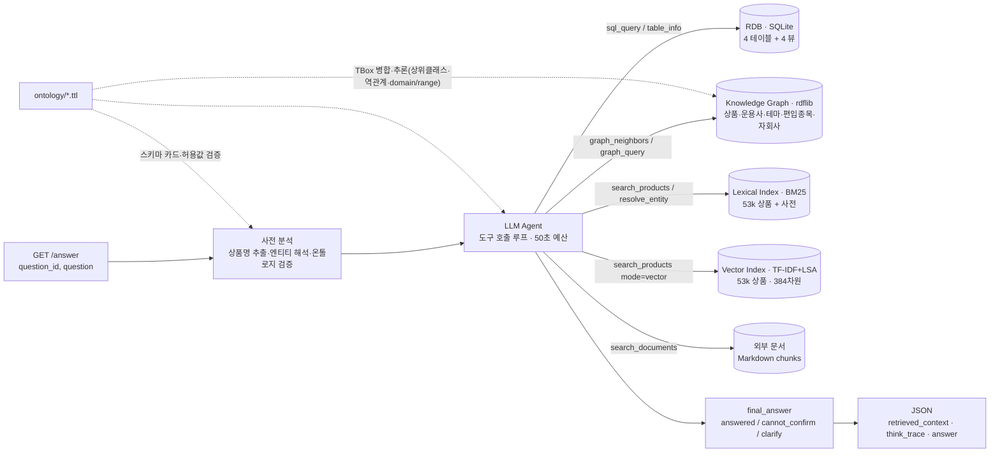

# 금융상품 Agent — Financial Product Analyst API

제10회 2026 미래에셋증권 AI Festival · 금융상품 Agent 과제 제출물.
국내채권·국내ETF·해외ETF·공모펀드 4종 상품 마스터(정형 데이터)를 Agent가 스스로 탐색·연산하고, 온톨로지로 검증된 근거를 붙여 답하는 `GET /answer` API입니다.

## 1. 아키텍처



| 구성 요소 | 역할 | 코드 |
|---|---|---|
| ETL | Excel 마스터 → SQLite(`data/store/products.db`). 날짜 ISO 변환, 판매가능 플래그, 펀드 패밀리 키, 운용사 정규화, 뷰 4개 | `src/finagent/etl/` |
| Ontology | `ontology/*.ttl`(TBox)을 런타임에 로드해 **스키마 카드**(컬럼 ↔ 한글 의미·단위·허용값)와 **검증기**(신용등급·위험등급 값 도메인)를 생성 | `src/finagent/ontology/loader.py` |
| Knowledge Graph | SQLite + 사전(운용사·테마·기업) + 편입종목 CSV로 ABox를 구축하고, **온톨로지 TBox를 병합해 추론**(상위 클래스·역관계·domain/range)까지 물질화 — 명시 97만 + 추론 10.9만 = 약 108만 트리플. SPARQL·이웃 조회 | `src/finagent/kb/graph.py` |
| Vector Index | 상품 텍스트의 밀집 벡터(의미) 검색. 기본 백엔드는 TF-IDF(단어+한글 bigram) → Truncated SVD 384차원 → 코사인 유사도로, **임베딩 API 키 없이 결정적으로 동작**. `VECTOR_BACKEND=openai`로 임베딩 API 전환 가능 | `src/finagent/kb/vector.py` |
| Lexical Index | BM25 + 한글 음절 bigram, 정확 상품명 부스트. 엔티티 해석기(정확 일치/유사 후보/기업 관계) | `src/finagent/kb/search.py`, `entity.py`, `lexicon.py` |
| Hybrid Retrieval | `search_products`가 어휘(BM25) + 의미(벡터)를 결합(`mode=hybrid`가 기본, `lexical`/`vector` 선택 가능) | `src/finagent/kb/vector.py` |
| Docs | 비정형 문서(PDF→Markdown) 청킹·검색. 출처·기준일 표기 | `src/finagent/kb/docs.py`, `scripts/parse_docs.py` |
| Agent | 도구 호출 LLM 루프(Anthropic 기본, OpenAI 호환 대체), 시간 예산, 근거·추적 수집, 답변 정책 | `src/finagent/agent/` |
| API | FastAPI `GET /answer`, `GET /health`. 항상 200 + 5개 필드 | `src/finagent/api.py` |

### 과제 필수 구성요소 대응

| 과제 요구 | 구현 |
|---|---|
| ① 정형·비정형 분석/정제 + 상품 도메인 특화 Ontology ([Parsing] pdf·ppt → Markdown) | `etl/`(정형 4종) · `scripts/parse_docs.py`(PDF/PPTX → Markdown, front-matter에 출처·기준일) · `ontology/*.ttl` 5종 |
| ② 금융상품 KnowledgeBase **RDB + Vector + Graph** ([Extraction]·[EntityResolution]) | RDB=SQLite 4뷰 · Vector=`kb/vector.py`(TF-IDF+LSA 384차원) · Graph=`kb/graph.py`(108만 트리플, 추론 포함) · Entity Resolution=`kb/entity.py` + `data/enrichment/*.yaml` |
| ③ Intent Analysis & Retrieval Engine ([NL2SQL]·[Retrieval]) | 사전 분석(의도·엔티티·온톨로지 검증) → LLM이 `sql_query`(NL2SQL)·그래프·하이브리드 검색을 우선순위대로 호출 |
| ④ Answer Generator (근거 기반·환각 방지) | `final_answer` 3상태 강제 + `retrieved_context` 근거 블록 + 확인불가/역질문 정책 |

### 검색 방법론 — 측정으로 결정한 부분

`search_products`의 하이브리드 결합 방식은 취향이 아니라 측정으로 정했습니다.

- 처음에는 BM25와 벡터를 **RRF(Reciprocal Rank Fusion)** 로 대등하게 결합했습니다. RRF는 두 검색기가 동의하는 문서를 상위로 올리는데, 이 코퍼스에서는 두 검색기가 각각 중간 순위로 올린 무관한 펀드가 최상위 어휘 매칭을 밀어내는 사례가 발생했습니다(예: "배터리 양극재 관련 상품" → 1위가 무관한 재간접 펀드).
- 최상위 후보가 틀리면 답변 생성이 오염되므로, 최종 구조는 **어휘 결과가 리스트의 머리(head)를 차지하고, 하위 약 30% 슬롯을 "의미 검색만 찾아낸" 문서에 할당**하는 방식입니다. 어휘 검색이 강한 질의에서 하이브리드는 어휘 검색보다 나빠질 수 없고(구조적 보장), 의미 검색은 recall 보강 역할을 합니다.
- 벡터 품질 자체도 측정으로 조정했습니다. 한글 상품명에는 `증권투자신탁·사모·파생형·상장지수` 같은 보일러플레이트가 많아 LSA 공간이 그 축에 지배되었고, 문서빈도 상위 토큰을 잘라내는 `max_df=0.005`로 바꾸자 7개 프로브 중 1개만 맞던 결과가 6개로 개선되었습니다(예: `space exploration satellite` → Procure Space ETF, `China semiconductor ETF` → 국내 반도체 ETF까지 recall).
- 크로스링구얼(한글 질의 ↔ 영문 해외ETF)은 벡터가 아니라 **테마 사전**(한/영 동의어)과 그래프 태깅으로 처리합니다.

### 온톨로지 추론 (기술세션 01-4 대응)

기동 시 TBox(`ontology/*.ttl`)를 ABox와 같은 그래프에 병합하고 세 가지 규칙을 물질화합니다: **상위 클래스 상속**(`x a fp:DomesticETF` → `x a fp:ETF`, `fp:Product`), **역관계**(`owl:inverseOf` 선언에 따라 `fp:managedBy` ↔ `fp:manages` 등), **domain/range 타입 추론**. 결과적으로 명시 969,880개 트리플에서 109,045개가 추론으로 생성되어, `?p a fp:Product`(51,990건)·`?am fp:manages ?p`(22,295건) 같은 질의가 별도 적재 없이 동작합니다. `/health`가 `kg_asserted`/`kg_inferred`로 이 수치를 보고합니다.

### 답변 정책 (평가 규칙 반영)
- 수치·상품명은 도구 결과에서만. 근거(테이블 한글명·기준일·상품코드·단위)를 답변과 `retrieved_context`에 표시.
- 확인 불가(존재하지 않는 상품/기업/값, 데이터 범위 밖) → `제공된 데이터로는 확인할 수 없습니다` 명시. 모호 → 역질문.
- 온톨로지 허용값 위반(예: 신용등급 AAAA, 위험등급 7)은 사전 분석에서 잡아 확인 불가로 보정.
- 수익률 전망·단정적 추천 금지.

## 2. 디렉터리

```
fin-agent/
├─ src/finagent/           # 구현체 (etl / ontology / kb / agent / api)
├─ ontology/               # common.ttl, bond_kr.ttl, etf_kr.ttl, etf_gl.ttl, fund_pub.ttl
├─ data/raw/               # 주최측 제공 Excel 8개 (data + schema)
├─ data/enrichment/        # managers.yaml, themes.yaml, companies.yaml, constituents/*.csv
├─ data/external/docs/     # 외부 참고 문서(Markdown, front-matter에 출처·기준일)
├─ data/eval/              # questions.jsonl (평가 재현용 질의 세트), results.jsonl
├─ data/store/             # 빌드 산출물 products.db (git 제외)
├─ scripts/                # build_store.py, eval_run.py, fetch_constituents_naver.py, parse_docs.py
├─ tests/                  # pytest
├─ docs/                   # api_spec.md, proposal_outline.md, superpowers/(설계·계획)
├─ requirements.txt · pyproject.toml · Dockerfile · docker-compose.yml · Caddyfile · .env.example
```

## 3. 환경 구성

요구사항: Python 3.11+ (3.12 권장, 3.14에서 개발), 메모리 4GB 이상(그래프 구축), 인터넷(LLM API).

```bash
git clone <this repo> && cd fin-agent
python -m venv .venv && source .venv/bin/activate        # Windows: .venv\Scripts\activate
pip install -r requirements.txt
cp .env.example .env                                     # LLM 키 입력
```

`.env` 핵심 값:

| 변수 | 기본값 | 설명 |
|---|---|---|
| `LLM_PROVIDER` | `anthropic` | `anthropic` / `openai`(OpenAI·Gemini OpenAI-compat·NCP CLOVA Studio 등 OpenAI 호환) / `stub`(테스트) |
| `LLM_MODEL` | `claude-opus-5` | 모델 ID. OpenAI 호환은 예: `gpt-4.1`, `gemini-2.5-pro` |
| `LLM_EFFORT` | `medium` | Claude 추론 깊이(`low`~`max`). 응답 시간과 트레이드오프 |
| `ANTHROPIC_API_KEY` / `OPENAI_API_KEY`, `OPENAI_BASE_URL` | | 제공자별 키·엔드포인트 |
| `ANTHROPIC_FALLBACKS` | `true` | Claude 서버측 안전 거부 대체 모델 자동 사용 |
| `TIME_BUDGET_SEC` | `50` | 문항당 내부 시간 예산 |
| `MAX_TOOL_ROUNDS` | `6` | 도구 호출 최대 라운드 |

## 4. 데이터 적재 및 실행

```bash
# (1) Excel → SQLite (약 1~2분, data/store/products.db 생성)
python scripts/build_store.py

# (2) 서버 실행 (기동 시 색인·벡터·그래프+추론 구축 약 2분, 재기동 시 벡터 캐시로 단축; /health 로 확인)
uvicorn finagent.api:app --host 0.0.0.0 --port 8000 --app-dir src
#   또는
python -m finagent.api

# (3) 호출
curl -G "http://127.0.0.1:8000/answer" --data-urlencode "question_id=Q-001" --data-urlencode "question=현재 판매가능한 원화채권 중 AA- 이상 종목 알려줘"
```

Docker (NCP VM 등):

```bash
docker compose up -d --build          # http://<host>/answer
# HTTPS가 필요하면 .env 에 DOMAIN=api.example.com 추가 후
docker compose --profile https up -d  # Caddy 가 Let's Encrypt 인증서를 자동 발급
```

## 5. API 명세

`GET /answer?question_id=Q-001&question=...` → `200 OK`

```json
{"question_id": "Q-001", "question": "...", "retrieved_context": "...", "think_trace": "...", "answer": "..."}
```

상세(요청/응답 JSON 스키마, 예시, 오류 처리): [docs/api_spec.md](docs/api_spec.md)

## 6. 온톨로지 (`ontology/`)

| 파일 | 내용 |
|---|---|
| `common.ttl` | 공통 상위 클래스 `fp:Product`, 운용사·발행사·기업·테마·지수·펀드패밀리, 위험등급(1~6)·자산군·투자지역·분배주기 열거형, 공통 관계(`managedBy`, `hasConstituent`, `subsidiaryOf`, `hasTheme`, `tracksIndex` …), SHACL 제약 |
| `bond_kr.ttl` | `fp:DomesticBond` — 신용등급 체계(AAA~D, 서열), 채권 분류·금리·이자지급 열거형, 수익률/듀레이션 등 속성 |
| `etf_kr.ttl` | `fp:DomesticETF` / `fp:DomesticETN` — 전략(실물/합성/액티브), 배수, 기간 수익률·변동성, 분배 정보 |
| `etf_gl.ttl` | `fp:ForeignETF` / `fp:ForeignETN` — 총보수, AUM, 거래소, 복제방법, 인버스/레버리지 |
| `fund_pub.ttl` | `fp:PublicFund` / `fp:PrivateFund` / `fp:ShareClass` — 운용속성, 제로인 유형, 벤치마크, 클래스 수수료·채널, 자산구성비율 |

모든 데이터 속성은 `fp:sourceTable` / `fp:sourceColumn` / `fp:unit` 주석을 가지며, 런타임(`ontology/loader.py`)이 이를 읽어 LLM 스키마 카드와 값 검증기를 만듭니다. 즉 온톨로지는 문서가 아니라 실행 계층입니다. 인스턴스(ABox)는 기동 시 SQLite에서 생성되며 `KG.export()`로 Turtle 내보내기가 가능합니다.

## 7. 평가 재현

```bash
# 서버 기동 후, 예시 질의 30개(PDF 예시 8 + 자체 22, 답변불가 8 포함) 실행 → 지연시간·상태 매칭 출력
python scripts/eval_run.py --base http://127.0.0.1:8000
```

결과는 `data/eval/results.jsonl`에 저장됩니다(문항별 `seconds`, `got` 상태, 근거·추적 전문).

테스트:

```bash
python -m pytest -q                 # 단위·계약 테스트 (stub LLM, 소형 스토어)
python -m pytest -q -m slow         # 전체 ETL 검증 (약 2분)
```

## 8. 외부 데이터 (규칙: 주최측 데이터 우선)

- `data/enrichment/constituents/kr_etf_constituents.csv` — 국내 ETF 1,162종목의 상위 편입종목(네이버금융, 수집일 CSV 참조). `scripts/fetch_constituents_naver.py`로 재수집. 그래프의 `hasConstituent` 관계에 사용(예: 에코프로 자회사 편입 ETF, 캠브리콘 편입 중국반도체 ETF).
- `data/enrichment/*.yaml` — 운용사 별칭, 테마 동의어(한/영), 기업(별칭·티커·모회사) 사전. 엔티티 해석과 그래프 관계의 원천.
- `data/external/docs/*.md` — 국민성장펀드 개요(금융위 보도자료 출처), ETF 용어·지표 해설, ETF 위험요인 일반. `scripts/parse_docs.py`로 PDF/PPTX를 Markdown으로 변환해 추가할 수 있습니다.

## 9. 제한 사항

- 상품 마스터는 2026-08-21/22 스냅샷이며 시세·수익률은 해당 기준일 값입니다.
- 국내ETF 총보수는 18%만 수록, 펀드 보수 컬럼은 단위 미공개(상대 비교만), 펀드 수익률은 약 30%만 수록 — 없는 값은 "데이터 없음"으로 답합니다.
- 해외ETF·펀드의 편입종목 데이터는 없습니다.
- 벡터 검색은 외부 임베딩 API 키 없이도 평가가 재현되도록 TF-IDF+LSA(384차원)를 기본값으로 씁니다. 상용 임베딩으로 바꾸면 의미 검색 품질이 더 오를 여지가 있으며, `VECTOR_BACKEND=openai`와 `VECTOR_EMBED_MODEL`로 전환할 수 있습니다(코드 변경 불필요).
- **제공 데이터가 과제설명 PDF의 기재와 다릅니다.** PDF는 4종 합계 약 14.5만 건·기준일 2026-07-11로 안내하지만, 실제 배포된 파일(`ai-festival2026_..._DtataSet260824.zip`)은 합계 53,375건이고 기준일이 2026-08-21(해외ETF 2026-08-22)입니다. 본 구현은 **실제 제공 파일**을 기준으로 하며, 평가용 데이터가 갱신되면 `python scripts/build_store.py` 재실행만으로 반영됩니다(스키마는 동일 가정).
