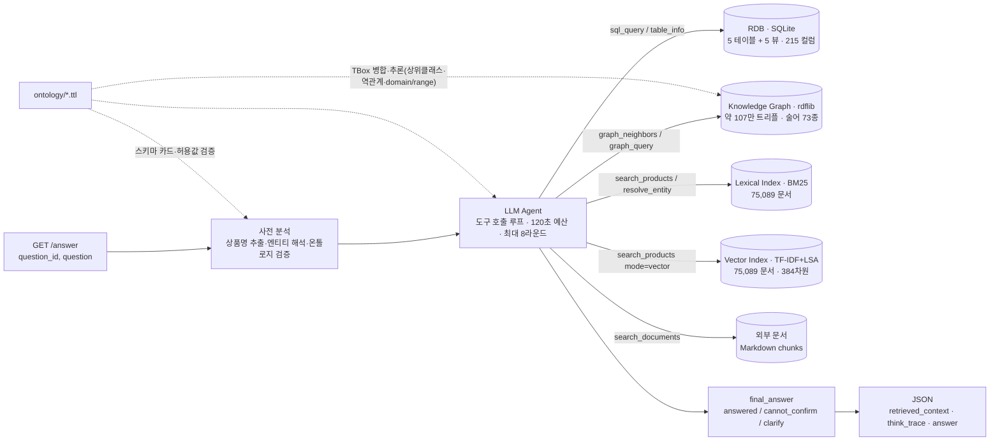

# 금융상품 Agent — Financial Product Analyst API

제10회 2026 미래에셋증권 AI Festival · 금융상품 Agent 과제 제출물. 팀명 **Wolves of Walnut Street**.
국내채권·국내ETF·해외ETF·공모펀드 4종 상품 마스터(정형 데이터)를 Agent가 스스로 탐색·연산하고, 온톨로지로 검증된 근거를 붙여 답하는 `GET /answer` API입니다.

## 0. 평가용 API End-point

```
http://223.130.161.217/answer
```

네이버 클라우드 플랫폼 VPC · Ubuntu 24.04 · Docker Compose · 표준 포트 80(HTTP). 운영 기간 2026-09-07 ~ 09-20.

호출 예시 (인증 헤더 없음, 경로는 `/answer` 고정):

```bash
curl -G "http://223.130.161.217/answer" \
  --data-urlencode "question_id=Q-001" \
  --data-urlencode "question=평가 질의"
```

응답은 `application/json`, 다섯 필드 모두 문자열입니다 — `question_id` · `question` · `retrieved_context` · `think_trace` · `answer`. 확인 불가 질의도 200 OK 로 동일 스키마를 유지합니다. 상세는 [`docs/api_spec.md`](docs/api_spec.md).

## 1. 아키텍처



| 구성 요소 | 역할 | 코드 |
|---|---|---|
| ETL | Excel 마스터 + 편입종목 CSV → SQLite(`data/store/products.db`). 날짜 ISO 변환, 판매가능 플래그, 펀드 패밀리 키, 운용사 정규화(기관코드 유래), **뷰 5개 · 215 컬럼 전량 노출** | `src/finagent/etl/` |
| Ontology | `ontology/*.ttl`(TBox)을 런타임에 로드해 **스키마 카드**(컬럼 ↔ 한글 의미·단위·허용값)와 **검증기**(신용등급·위험등급 값 도메인)를 생성 | `src/finagent/ontology/loader.py` |
| Knowledge Graph | SQLite(`etf_constituent` 포함) + 사전(운용사·테마·기업)으로 ABox를 구축하고, **온톨로지 TBox를 병합해 추론**(상위 클래스·역관계·domain/range)까지 물질화 — 약 **1,074,824 트리플 · 술어 73종**. 편입종목은 그래프가 아니라 SQLite 테이블에서 생성되므로 SQL 결과와 그래프 결과가 갈라지지 않는다. SPARQL·이웃 조회 | `src/finagent/kb/graph.py` |
| Vector Index | 상품 텍스트의 밀집 벡터(의미) 검색. 기본 백엔드는 TF-IDF(단어+한글 bigram) → Truncated SVD 384차원 → 코사인 유사도로, **임베딩 API 키 없이 결정적으로 동작**. `VECTOR_BACKEND=openai`로 임베딩 API 전환 가능 | `src/finagent/kb/vector.py` |
| Lexical Index | BM25 + 한글 음절 bigram, 정확 상품명 부스트. 엔티티 해석기(정확 일치/유사 후보/기업 관계) | `src/finagent/kb/search.py`, `entity.py`, `lexicon.py` |
| Hybrid Retrieval | `search_products`가 어휘(BM25) + 의미(벡터)를 결합(`mode=hybrid`가 기본, `lexical`/`vector` 선택 가능) | `src/finagent/kb/vector.py` |
| Docs | 비정형 문서(PDF→Markdown) 청킹·검색. 출처·기준일 표기 | `src/finagent/kb/docs.py`, `scripts/parse_docs.py` |
| Agent | 도구 호출 LLM 루프(Anthropic 기본, OpenAI 호환 대체), 시간 예산, 근거·추적 수집, 답변 정책 | `src/finagent/agent/` |
| API | FastAPI `GET /answer`, `GET /health`. 항상 200 + 5개 필드 | `src/finagent/api.py` |

### 과제 필수 구성요소 대응

| 과제 요구 | 구현 |
|---|---|
| ① 정형·비정형 분석/정제 + 상품 도메인 특화 Ontology ([Parsing] pdf·ppt → Markdown) | `etl/`(정형 4종 + 편입종목) · `scripts/parse_docs.py`(PDF/PPTX → Markdown, front-matter에 출처·기준일) · `ontology/*.ttl` **6종** |
| ② 금융상품 KnowledgeBase **RDB + Vector + Graph** ([Extraction]·[EntityResolution]) | RDB=SQLite **5뷰 · 215컬럼** · Vector=`kb/vector.py`(TF-IDF+LSA 384차원) · Graph=`kb/graph.py`(약 107만 트리플, 추론 포함) · Entity Resolution=`kb/entity.py` + `data/enrichment/*.yaml`. 어휘·벡터 색인은 **75,089 문서** |
| ③ Intent Analysis & Retrieval Engine ([NL2SQL]·[Retrieval]) | 사전 분석(의도·엔티티·온톨로지 검증) → LLM이 `sql_query`(NL2SQL)·그래프·하이브리드 검색을 우선순위대로 호출 |
| ④ Answer Generator (근거 기반·환각 방지) | `final_answer` 3상태 강제 + `retrieved_context` 근거 블록 + 확인불가/역질문 정책 |

### 검색 방법론 — 측정으로 결정한 부분

`search_products`의 하이브리드 결합 방식은 취향이 아니라 측정으로 정했습니다.

- 처음에는 BM25와 벡터를 **RRF(Reciprocal Rank Fusion)** 로 대등하게 결합했습니다. RRF는 두 검색기가 동의하는 문서를 상위로 올리는데, 이 코퍼스에서는 두 검색기가 각각 중간 순위로 올린 무관한 펀드가 최상위 어휘 매칭을 밀어내는 사례가 발생했습니다(예: "배터리 양극재 관련 상품" → 1위가 무관한 재간접 펀드).
- 최상위 후보가 틀리면 답변 생성이 오염되므로, 최종 구조는 **어휘 결과가 리스트의 머리(head)를 차지하고, 하위 약 30% 슬롯을 "의미 검색만 찾아낸" 문서에 할당**하는 방식입니다. 어휘 검색이 강한 질의에서 하이브리드는 어휘 검색보다 나빠질 수 없고(구조적 보장), 의미 검색은 recall 보강 역할을 합니다.
- 벡터 품질 자체도 측정으로 조정했습니다. 한글 상품명에는 `증권투자신탁·사모·파생형·상장지수` 같은 보일러플레이트가 많아 LSA 공간이 그 축에 지배되었고, 문서빈도 상위 토큰을 잘라내는 `max_df=0.005`로 바꾸자 7개 프로브 중 1개만 맞던 결과가 6개로 개선되었습니다(예: `space exploration satellite` → Procure Space ETF, `China semiconductor ETF` → 국내 반도체 ETF까지 recall).
- 크로스링구얼(한글 질의 ↔ 영문 해외ETF)은 벡터가 아니라 **테마 사전**(한/영 동의어)과 그래프 태깅으로 처리합니다.

### 데이터 모델 (뷰 5개)


읽는 법:

- **실제 외래키는 하나뿐입니다.** `v_etf_constituent.etf_itm_no` → `v_etf_kr.pd_itm_no`. 나머지 네 뷰는 상품군이 달라 공통 키가 없으므로, 교차질의는 조인이 아니라 `UNION ALL`로 풉니다.
- `v_fund_pub` 1행 = **펀드 클래스 1개**. "펀드 몇 개"를 물으면 `COUNT(DISTINCT fund_family)`로 세야 합니다(23,676행 = 17,795 펀드).
- `v_bond_kr`은 한 `pd_no`에 여러 행이 올 수 있습니다(장내/장외 구분, 장외는 LOT 단위 `info_seq`). 종목 수를 세려면 `COUNT(DISTINCT pd_no)`.
- 해외ETF·공모펀드의 **편입종목 데이터는 없습니다**. 편입종목은 국내 ETF에만 존재합니다.
- 위 표는 조인·식별에 쓰이는 컬럼만 뽑은 것이고, 실제로는 5개 뷰에 **215개 컬럼**이 있으며 전량이 스키마 카드로 노출됩니다.

### 결측치 식별과 보완

제공 데이터의 결측은 **의도된 것**(주최측 공지)이므로 0으로 계산하지 않습니다. 다만 *우리가 만든 파생 컬럼*의 결측은 원천에 더 나은 근거가 있으면 채웁니다.

| 대상 | 어떻게 식별했나 | 어떻게 채웠나 | 결과 |
|---|---|---|---|
| 펀드 `manager_name` | 컬럼별 NULL 비율 점검에서 **25.4% 결측** 발견. 원인은 펀드 이름 접두어로 운용사를 추측한 것 | 주최측이 **100% 채워서 주는** `or_co_xtn_itt_cd`(운용사 기관코드)에서 유도. 코드별 다수 표기를 대표명으로 사용 | 17,660행(74.6%) → **21,592행(91.2%)**. 채움 출처를 `manager_source`(name 17,660 / code 3,932 / NULL 2,084)에 기록 |
| 편입종목 종목코드 | 원천(네이버금융)이 `itemCode`를 주는데 수집기가 버리고 있었음 | 수집기에서 보존 | **79%** 행이 종목코드 보유. 기업 식별은 이름 유사도가 아니라 이 코드로만 |
| 국내ETF 총보수 · 펀드 수익률 | 원천 자체가 부분 수록(총보수 18%, 펀드 수익률 약 30%) | **채우지 않음.** 값이 없으면 "데이터 없음"으로 답함 | — |

운용사 개명은 별도 표를 만들지 않았습니다. 펀드 설정일이 없으면 두 표기 중 어느 쪽이 현재 이름인지 판정할 수 없기 때문에, 기관코드에 딸린 다수 표기를 그대로 씁니다(옛 브랜드명일 수 있음).

### 온톨로지 추론 (기술세션 01-4 대응)

기동 시 TBox(`ontology/*.ttl`)를 ABox와 같은 그래프에 병합하고 세 가지 규칙을 물질화합니다: **상위 클래스 상속**(`x a fp:DomesticETF` → `x a fp:ETF`, `fp:Product`), **역관계**(`owl:inverseOf` 선언에 따라 `fp:managedBy` ↔ `fp:manages` 등), **domain/range 타입 추론**. 그 결과 `?p a fp:Product`·`?am fp:manages ?p` 같은 질의가 별도 적재 없이 동작합니다. 현재 그래프는 약 **1,074,824 트리플 · 술어 73종**이며, 명시/추론 트리플 수는 `/health`가 `kg_asserted`/`kg_inferred`로 보고합니다.

> 이전에는 술어가 **5,082종**이었습니다. 편입 비중을 `weight_<기업명>`처럼 기업마다 다른 술어로 적었기 때문인데, 편입종목이 SQLite 테이블로 내려오면서 비중은 컬럼이 되었고 술어는 73종으로 정리됐습니다.

### 주최측 공지 반영 (2026-08-24)

| 공지 | 반영 |
|---|---|
| 답변 생성 파이프라인은 **NCP HyperCLOVA X 필수** | `LLM_PROVIDER=clova` 기본값, CLOVA Studio OpenAI 호환 엔드포인트로 function calling 사용 |
| `BUYABLE_QUANTITY` 값 무효, 상장폐지·리스팅 종료 제외 종목은 모두 구매가능 | `is_sellable` 재정의 — 채권은 **상환 미도래 21,866건**(기존 634건). 매수수익률 수록 종목은 `has_buy_yield`로 분리 |
| 0·결측값은 의도된 것, 값을 빼거나 없다고 응답 | 프롬프트 규칙 6번에 명시. NULL을 0으로 계산·정렬하지 않음 |
| 총 35문항(상10/중10/하10 + 답변불가 5) | 평가 세트를 그 구성에 맞춰 확장. 정답 키 **54문항**(하 10 · 중 16 · 상 9 · 답변불가 19) |
| 교차질의(2개 이상 상품군 비교) 출제 | 프롬프트에 `UNION ALL` 패턴과 "해외ETF는 1년 수익률 미제공" 처리 지침 추가 |
| 코드값 테이블 미제공, 해당 질의 없음 | 원문 코드값 해석에 의존하지 않음 |
| 300초 초과는 미응답, 그 안이면 늦어도 채점(점수 차등) | 내부 예산 50초 → **120초**, 라운드 6 → 8 |

### 답변 정책 (평가 규칙 반영)
- 수치·상품명은 도구 결과에서만. 근거(테이블 한글명·기준일·상품코드·단위)를 답변과 `retrieved_context`에 표시.
- 확인 불가(존재하지 않는 상품/기업/값, 데이터 범위 밖) → `제공된 데이터로는 확인할 수 없습니다` 명시. 모호 → 역질문.
- 온톨로지 허용값 위반(예: 신용등급 AAAA, 위험등급 7)은 사전 분석에서 잡아 확인 불가로 보정.
- 수익률 전망·단정적 추천 금지.

## 2. 디렉터리

```
fin-agent/
├─ src/finagent/           # 구현체 (etl / ontology / kb / agent / api)
├─ ontology/               # common.ttl, bond_kr.ttl, etf_kr.ttl, etf_gl.ttl, fund_pub.ttl, etf_constituent.ttl (6종)
├─ data/raw/               # 주최측 제공 Excel 8개 (data + schema)
├─ data/enrichment/        # managers.yaml, themes.yaml, companies.yaml, constituents/*.csv
├─ data/external/docs/     # 외부 참고 문서(Markdown, front-matter에 출처·기준일)
├─ data/eval/              # questions.jsonl(상태 점검 33문항), groundtruth.jsonl(정답 키 54문항), results.jsonl
├─ data/store/             # 빌드 산출물 products.db (git 제외)
├─ scripts/                # build_store.py, warmup.py, explore.py, eval_run.py, eval_truth.py, fetch_constituents_naver.py, parse_docs.py
├─ tests/                  # pytest
├─ docs/                   # anatomy.html(전체 해설), api_spec.md, proposal_outline.md, superpowers/
├─ requirements.txt · pyproject.toml · Dockerfile · docker-compose.yml · Caddyfile · .env.example
```

## 3. 환경 구성

요구사항: Python 3.11+ (3.12 권장, 3.14에서 개발), 메모리 4GB 이상(그래프 구축), 인터넷(LLM API).

```bash
git clone <this repo> && cd fin-agent
python -m venv .venv && source .venv/bin/activate        # Windows: .venv\Scripts\activate
pip install -r requirements.txt
cp .env.example .env                                     # LLM 키 입력
```

`.env` 핵심 값:

| 변수 | 기본값 | 설명 |
|---|---|---|
| `LLM_PROVIDER` | `clova` | **대회 규정상 `clova` 고정.** `anthropic`/`openai`는 개발 비교용, `stub`은 테스트용 |
| `LLM_MODEL` | `HCX-005` | CLOVA Studio 모델 ID |
| `CLOVA_API_KEY` | | CLOVA Studio 테스트앱/서비스앱 API 키 |
| `CLOVA_BASE_URL` | `https://clovastudio.stream.ntruss.com/v1/openai` | OpenAI 호환 엔드포인트 |
| `LLM_MAX_TOKENS` | `4096` | CLOVA function calling은 **1024 이상 필수**(미만이면 자동 상향) |
| `TIME_BUDGET_SEC` | `120` | 문항당 내부 시간 예산 (300초 초과 시 미응답 처리) |
| `MAX_TOOL_ROUNDS` | `8` | 도구 호출 최대 라운드 |
| `VECTOR_BACKEND` | `lsa` | `lsa`(오프라인 TF-IDF+SVD, 키 불필요) / `openai`(임베딩 API) / `off` |
| `VECTOR_DIMS`, `VECTOR_MAX_DF` | `384`, `0.005` | 벡터 차원 수와 고빈도 토큰 제거 임계값 |

## 4. 데이터 적재 및 실행

```bash
# (1) Excel → SQLite (약 1~2분, data/store/products.db 생성)
python scripts/build_store.py

# (2) (선택) 벡터 캐시 예열 — 이후 기동 시간을 약 80초 단축
python scripts/warmup.py

# (3) 서버 실행 (기동 시 색인·벡터·그래프+추론 구축: 캐시 있으면 약 1분 30초, 없으면 3~3.5분. /health 로 확인)
uvicorn finagent.api:app --host 0.0.0.0 --port 8000 --app-dir src
#   또는
python -m finagent.api

# (4) 호출
curl -G "http://127.0.0.1:8000/answer" --data-urlencode "question_id=Q-001" --data-urlencode "question=현재 판매가능한 원화채권 중 AA- 이상 종목 알려줘"
```

Docker (NCP VM 등):

```bash
docker compose up -d --build          # http://<host>/answer
# HTTPS가 필요하면 .env 에 DOMAIN=api.example.com 추가 후
docker compose --profile https up -d  # Caddy 가 Let's Encrypt 인증서를 자동 발급
```

## 5. API 명세

`GET /answer?question_id=Q-001&question=...` → `200 OK`

```json
{"question_id": "Q-001", "question": "...", "retrieved_context": "...", "think_trace": "...", "answer": "..."}
```

상세(요청/응답 JSON 스키마, 예시, 오류 처리): [docs/api_spec.md](docs/api_spec.md)

## 6. 온톨로지 (`ontology/`)

| 파일 | 내용 |
|---|---|
| `common.ttl` | 공통 상위 클래스 `fp:Product`, 상장 상품 구분 `fp:DomesticListedProduct` / `fp:ForeignListedProduct`, 운용사·발행사·기업·테마·지수·펀드패밀리, 위험등급(1~6)·자산군·투자지역·분배주기 열거형, 공통 관계(`managedBy`, `hasConstituent`, `subsidiaryOf`, `hasTheme`, `tracksIndex` …), SHACL 제약 |
| `bond_kr.ttl` | `fp:DomesticBond` — 신용등급 체계(AAA~D, 서열), 채권 분류·금리·이자지급 열거형, 수익률/듀레이션 등 속성 |
| `etf_kr.ttl` | `fp:DomesticETF` / `fp:DomesticETN` — 전략(실물/합성/액티브), 배수, 기간 수익률·변동성, 분배 정보 |
| `etf_gl.ttl` | `fp:ForeignETF` / `fp:ForeignETN` — 총보수, AUM, 거래소, 복제방법, 인버스/레버리지 |
| `fund_pub.ttl` | `fp:PublicFund` / `fp:PrivateFund` / `fp:ShareClass` — 운용속성, 제로인 유형, 벤치마크, 클래스 수수료·채널, 자산구성비율, 운용사 기관코드와 채움 출처(`manager_source`) |
| `etf_constituent.ttl` | 국내 ETF 편입종목 — 편입 관계, 종목코드·비중·현금성 여부·기준일. 그래프의 `hasConstituent`가 이 뷰에서 생성됩니다 |

모든 데이터 속성은 `fp:sourceTable` / `fp:sourceColumn` / `fp:unit` 주석을 가지며, 런타임(`ontology/loader.py`)이 이를 읽어 LLM 스키마 카드와 값 검증기를 만듭니다. 즉 온톨로지는 문서가 아니라 실행 계층입니다. 인스턴스(ABox)는 기동 시 SQLite에서 생성되며 `KG.export()`로 Turtle 내보내기가 가능합니다.

## 7. 평가 재현

```bash
# (A) 정답 키 기반 채점 — 데이터에서 SQL/그래프로 계산한 정답과 대조 (권장)
python scripts/eval_truth.py --compute                      # 정답 키만 확인 (LLM 불필요)
python scripts/eval_truth.py --base http://127.0.0.1:8000   # 서버 답변 채점

# (B) 상태 기반 점검 — 33문항의 응답 상태·지연시간 확인 (정답 대조 없음)
python scripts/eval_run.py --base http://127.0.0.1:8000

# LLM 없이 각 저장소를 직접 들여다보기 (키 불필요)
python scripts/explore.py health
python scripts/explore.py search "차이나 반도체" --mode hybrid
python scripts/explore.py pre "신용등급 AAAA인 채권 찾아줘"
```

결과는 `data/eval/results.jsonl` / `data/eval/truth_results.jsonl`에 저장됩니다(문항별 `seconds`, 채점 결과, 근거·추적 전문).

> **정답 기준에 대하여** — 주최측은 평가 질의와 정답을 공개하지 않았습니다(과제설명서: "예시질문(참고용 질의set)은 본 자료에 포함되지 않습니다").
> 따라서 `data/eval/groundtruth.jsonl`은 **제공 데이터에서 SQL·그래프로 정답이 계산되는 질문 54개**(하 10 · 중 16 · 상 9 · 답변불가 19)로 구성했습니다.
> 정답 키는 채점 시점에 데이터에서 다시 계산되므로, 데이터가 갱신되면 정답도 함께 갱신됩니다.
>
> **정답률은 아직 측정하지 않았습니다.** 정답 키를 20 → 54문항으로 늘리면서 키 자체의 오류(ETF를 묻는 문항에서 ETN을 센 것, 동률 답을 하나로 고정한 것,
> 반올림 정수를 허용해 0.65가 "1"로도 통과하던 것)를 함께 고쳤기 때문에 이전 채점 결과는 폐기했고, 새 세트로는 아직 실행하지 않았습니다.

테스트:

```bash
python -m pytest -q                 # 단위·계약 테스트 (stub LLM, 소형 스토어)
python -m pytest -q -m slow         # 전체 ETL 검증 (약 2분)
```

## 8. 외부 데이터 (규칙: 주최측 데이터 우선)

- `data/enrichment/constituents/kr_etf_constituents.csv` — 국내 ETF **1,162종목 · 22,599행**의 상위 편입종목(네이버금융, `as_of` 2026-09-05). `scripts/fetch_constituents_naver.py`로 재수집.
  `build_store.py`가 이 CSV를 **SQLite 테이블 `etf_constituent`(뷰 `v_etf_constituent`)로 적재**하고, 지식그래프의 `hasConstituent`는 그 테이블에서 생성됩니다 — SQL 결과와 그래프 결과가 갈라지지 않습니다.
  기업 식별은 원천이 주는 **종목코드**(`company_code`, 79% 수록)로만 합니다. 이름 유사도 매칭은 쓰지 않습니다(과거 `"lg"`가 `"shinhanfinancialgroup"`의 부분 문자열로 잡혀 677행이 오귀속된 적이 있습니다).
- `data/enrichment/*.yaml` — 운용사 77 · 테마 48(한/영) · 기업 97(별칭·티커·모회사) 사전. 엔티티 해석과 그래프 관계의 원천.
  이 중 `subsidiaryOf`(모회사·자회사)는 **엣지 4개**뿐입니다 — 주최측 4종 마스터에 소유 관계 컬럼이 아예 없고, 제공 데이터에서 계산한다는 규칙을 지켜 확장하지 않았습니다. "다단계 자회사 순회"를 일반 기능으로 소개하지 않습니다.
- `data/external/docs/*.md` — 국민성장펀드 개요(금융위 보도자료 출처), ETF 용어·지표 해설, ETF 위험요인 일반. `scripts/parse_docs.py`로 PDF/PPTX를 Markdown으로 변환해 추가할 수 있습니다.

## 9. 제한 사항

- 상품 마스터는 2026-08-21/22 스냅샷이며 시세·수익률은 해당 기준일 값입니다.
- 국내ETF 총보수는 18%만 수록, 펀드 보수 컬럼은 단위 미공개(상대 비교만), 펀드 수익률은 약 30%만 수록 — 없는 값은 "데이터 없음"으로 답합니다.
- 해외ETF·펀드의 편입종목 데이터는 없습니다. 편입종목은 국내 ETF에만 있습니다(1,235개 중 1,162개 수집).
- 편입종목의 기준일(`as_of` 2026-09-05)이 상품 마스터 기준일(2026-08-21/22)과 다릅니다. 두 소스를 섞어 답할 때는 시점 차이를 함께 밝힙니다.
- 펀드 운용사는 91.2% 채워져 있고 **2,084행은 여전히 NULL**입니다(기관코드가 특정 표기로 수렴하지 않는 경우). 운용사 개명 대응표는 만들지 않았습니다 — 펀드 설정일이 없어 어느 표기가 현재 이름인지 판정할 수 없기 때문입니다.
- `subsidiaryOf` 관계는 엣지 4개입니다(에코프로 계열 3 · SK이노베이션 1).
- 벡터 검색은 외부 임베딩 API 키 없이도 평가가 재현되도록 TF-IDF+LSA(384차원)를 기본값으로 씁니다. 상용 임베딩으로 바꾸면 의미 검색 품질이 더 오를 여지가 있으며, `VECTOR_BACKEND=openai`와 `VECTOR_EMBED_MODEL`로 전환할 수 있습니다(코드 변경 불필요).
- **제공 데이터가 과제설명 PDF의 기재와 다릅니다.** PDF는 4종 합계 약 14.5만 건·기준일 2026-07-11로 안내하지만, 실제 배포된 파일(`ai-festival2026_..._DtataSet260824.zip`)은 합계 53,375건이고 기준일이 2026-08-21(해외ETF 2026-08-22)입니다. 본 구현은 **실제 제공 파일**을 기준으로 하며, 평가용 데이터가 갱신되면 `python scripts/build_store.py` 재실행만으로 반영됩니다(스키마는 동일 가정).
