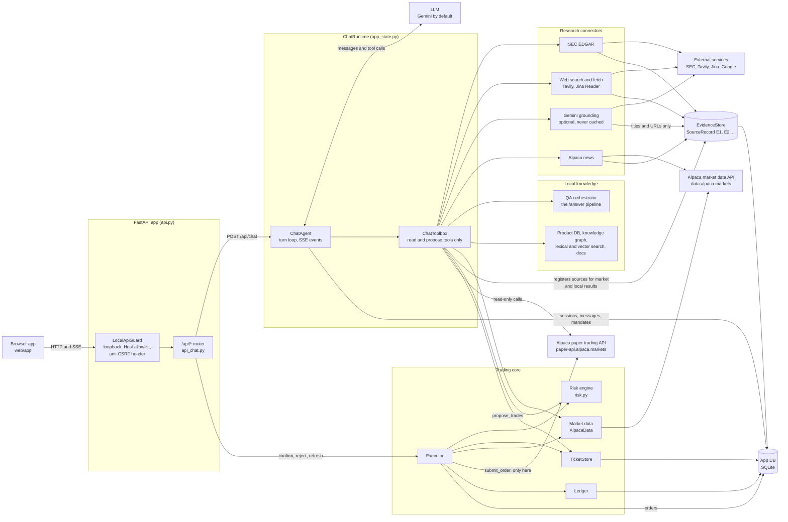
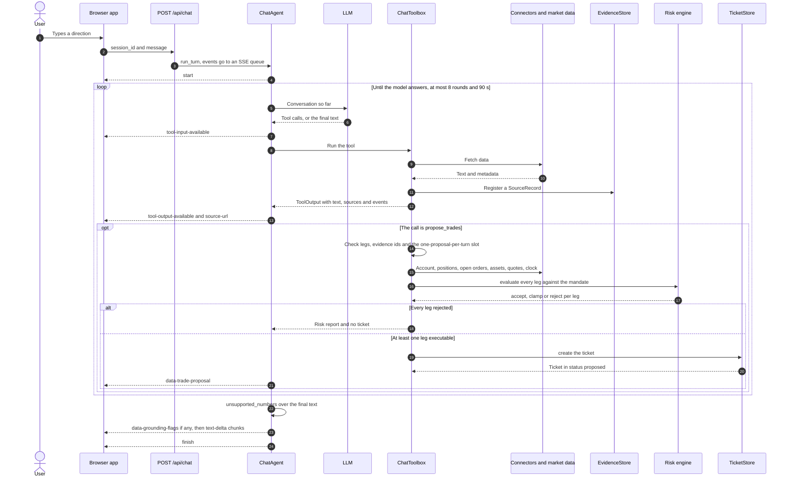
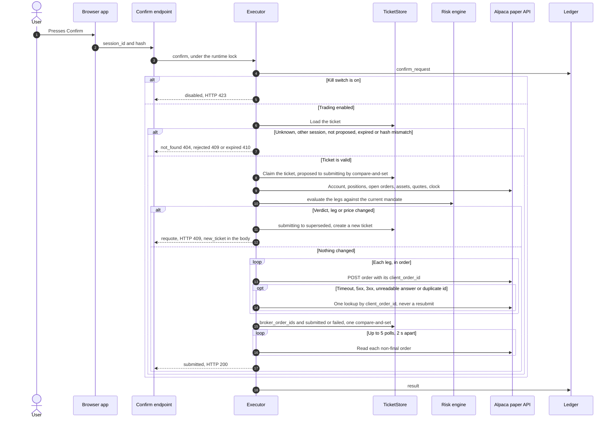
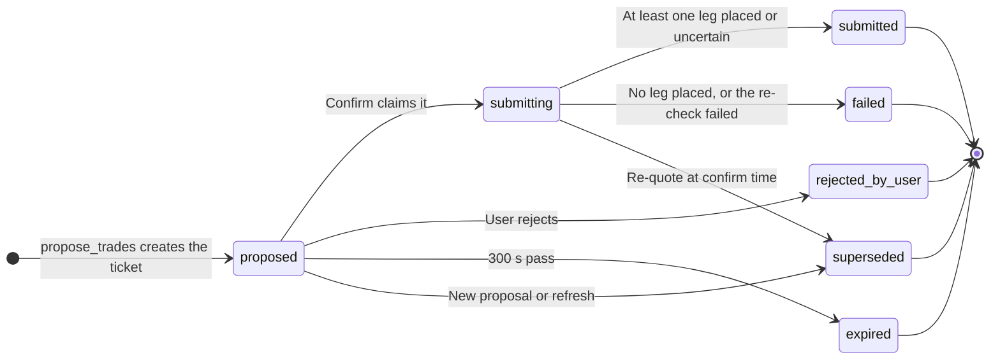
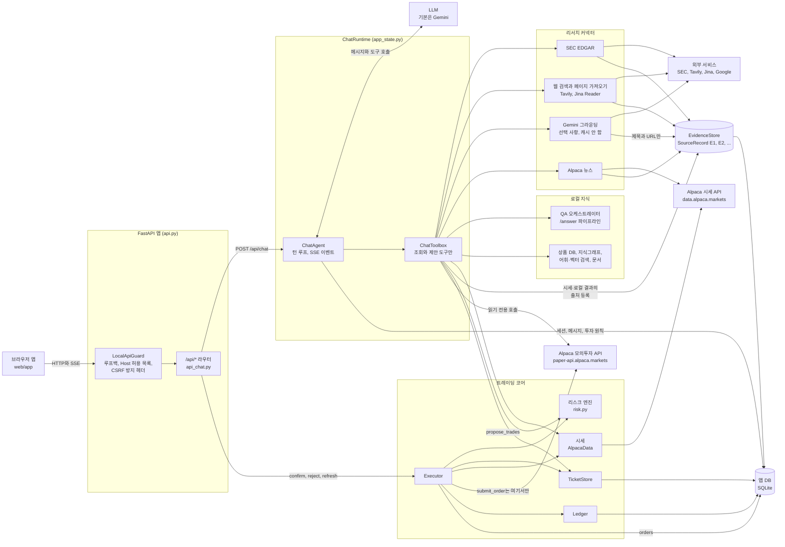
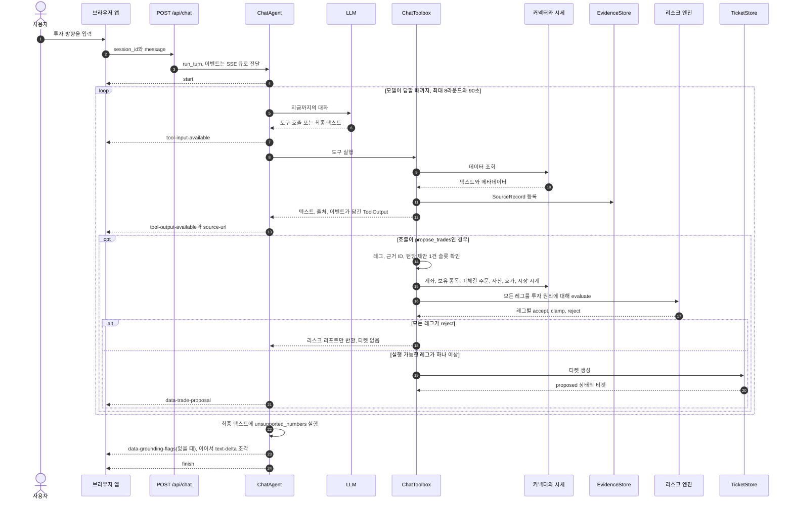
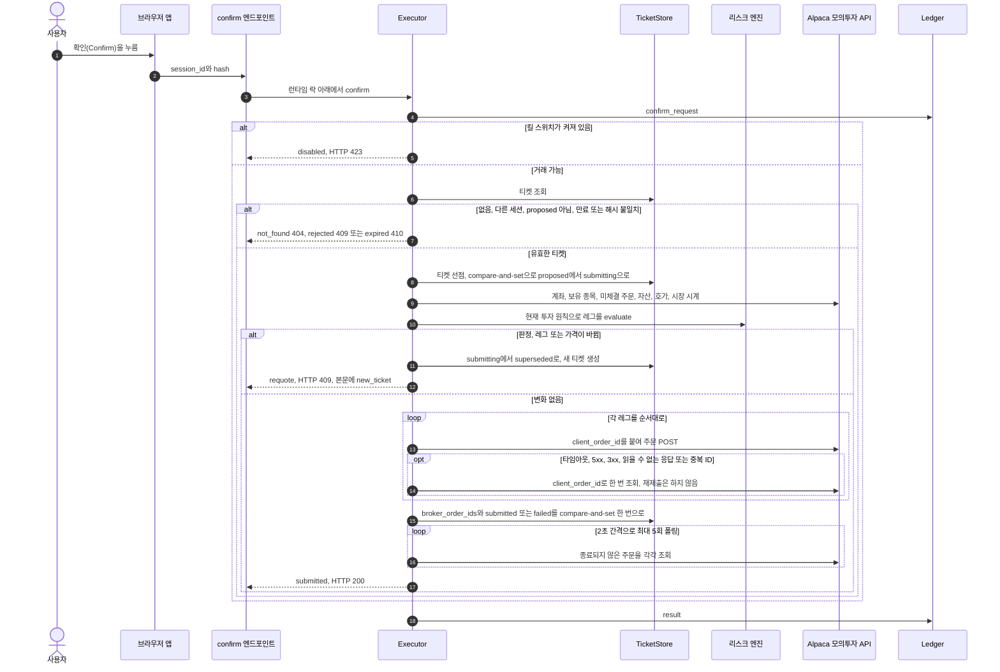
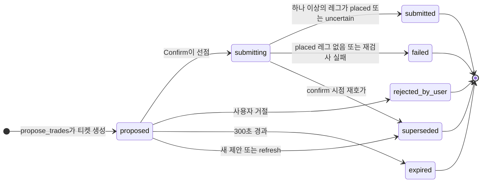

**English** | [한국어](#한국어)

# Paper-Trading Assistant: Architecture

This document describes the paper-trading assistant that sits on top of the financial-product QA pipeline. It explains how the pieces fit together and why the order path is built the way it is. For the HTTP surface (paths, bodies, status codes, the SSE events) see [api_spec.md](api_spec.md). For the original design and plan see [the design spec](superpowers/specs/2026-09-26-trading-agent-design.md) and [the implementation plan](superpowers/plans/2026-09-26-trading-agent.md).

This document was written from the code, not from the plan. Where the code differs from the design spec, it follows the code and says so.

## 1. Overview

The user chats with an agent. The agent researches through tools, explains a strategy with `[E#]` citations, and proposes a **ticket**: a risk-checked, hashed set of orders with a short lifetime. The human confirms the ticket in the browser, and only that confirmation makes code submit orders, and only to an Alpaca **paper** account. The rule behind the whole design: **the LLM proposes, code decides, the human approves.**

The existing single-question QA pipeline (`GET /answer`, the orchestrator, the product database, the knowledge graph and the search indexes) is unchanged. The chat agent reuses it as one of its tools (`ask_product_database`). New code lives in three packages beside it: `research/` (connectors and the evidence store), `trading/` (broker, market data, risk, tickets, execution, ledger) and `chat/` (sessions, toolbox, prompt, agent loop). `api_chat.py` exposes them under `/api/*`.

### Component diagram

### Who decides what

| Step | The LLM | Code | The human |
|---|---|---|---|
| Research | chooses tools and queries | runs the connectors, sanitizes and wraps external text, assigns evidence ids | reads the sources |
| Numbers | quotes what tools return | computes prices, returns, volatility, drawdown, costs and sizes in `Decimal` | |
| Mandate | can only draft changes (`draft_mandate`) | validates and stores the saved mandate | reviews and saves it in the UI |
| Proposal | drafts legs, thesis, risks, invalidation, evidence ids | validates the legs, risk-checks every leg, clamps or rejects it, issues a hashed ticket with a 5-minute lifetime | reads the ticket |
| Order | has no order tool at all | re-checks at confirm time, submits once per leg, reconciles uncertain outcomes | presses Confirm |

## 2. The federated research layer

"Federated" here means one question fans out to sources of very different kinds behind one interface, and every result keeps its provenance.

### Sources

| Source | Tools | Evidence `connector` | Tier | Untrusted | Cache |
|---|---|---|---|---|---|
| Local product database, knowledge graph and search | `screen_us_etfs` (over `v_etf_gl`), `search_products`, `graph_neighbors` | `product_db`, `product_kb` | 1 | no | none: read directly |
| Local QA pipeline (the `/answer` orchestrator) | `ask_product_database` | `product_qa` | 1 | no | none |
| Alpaca market data: quotes and daily bars | `get_quotes`, `price_metrics` | `alpaca_quotes`, `alpaca_bars` | 1 | no | none |
| Alpaca screener | `get_movers` | `alpaca_screener` | 2 | yes | none |
| Alpaca news | `search_news` | `news` | 2 | yes | none |
| SEC EDGAR: filing lists, XBRL company facts | `sec_filings`, `sec_financial_facts` | `edgar` | 1 | no | ticker map 24 h, submissions and company facts 12 h |
| SEC EDGAR: filing text passages | `sec_filing_passages` | `edgar` | 1 | yes | filing documents effectively permanent (filings are immutable) |
| Web search and page fetch | `web_search` (Tavily), `fetch_source` (Tavily extract, Jina Reader as the keyless fallback) | `websearch` | 1 to 4 by domain | yes | search 15 min for `topic=news`, 12 h otherwise; fetched pages 12 h |
| Gemini Google Search grounding | `grounded_web_answer` | `grounded_web` | 3 | yes | never |

The web tier is a coarse domain rule, not a curated allowlist. Tier 1: `sec.gov`, the main exchanges and hosts that start with `ir.`, `investor.` or `investors.`. Tier 2: Reuters, Bloomberg, WSJ, FT, Benzinga. Tier 4: Reddit, Medium, Substack and similar blog and forum platforms. Everything else is tier 3. Local and broker data are tier 1 because they are the primary data for this app, not because a domain says so.

All connector HTTP goes through one `HttpClient`: per-host rate limits (SEC 5 requests/s, Tavily 1.5/s, Jina Reader 0.3/s), up to 3 attempts for GET on 429 and 5xx, no retry for POST, and log redaction of credential-looking headers and query parameters.

### Tool availability

A tool whose dependency is not configured is left out of the tool list (it is not stubbed), and the system prompt only names tools that exist.

| Needs | Tools |
|---|---|
| Alpaca paper keys (broker and market data) | `get_account`, `get_positions`, `list_orders`, `get_market_status`, `lookup_asset`, `get_quotes`, `price_metrics`, `get_movers`, `search_news`, `propose_trades` |
| `SEC_USER_AGENT` | `sec_filings`, `sec_financial_facts`, `sec_filing_passages` |
| `TAVILY_API_KEY` | `web_search` |
| Gemini as the LLM provider with a key | `grounded_web_answer` |
| Nothing extra | `fetch_source` (Jina Reader works without a key), `screen_us_etfs`, `ask_product_database`, `search_products`, `graph_neighbors`, `draft_mandate` |

### Every result becomes a source record

Whatever a research tool returns is registered in the session's `EvidenceStore` as a `SourceRecord` before the model sees it. Ids are `E1`, `E2`, ... per session. Each record carries a tier and an `untrusted` flag. Section 7 describes the fields and how citations are checked.

### External text is untrusted

Web pages, news, filing text, screener strings, grounded answers and broker error messages are written by third parties, so they are treated as data that may contain instructions aimed at the model.

1. `sanitize_untrusted` reduces the text to what a person would see on the rendered page. It drops tags, comments, `script`, `style`, `template` and `iframe` content, elements hidden with the `hidden` attribute, `aria-hidden="true"` or inline CSS (`display:none`, `visibility:hidden`, `opacity:0`, `font-size:0`), and zero-width characters. It then collapses whitespace and caps the length.
2. `wrap_untrusted` puts the result in `<untrusted source="E7">...</untrusted>`. A closing `</untrusted>` inside the text is escaped, so injected text cannot end the block early.
3. `ChatToolbox` re-checks every connector result. Unless every untrusted source has its own block and no stray wrapper tag sits outside the blocks, the toolbox sanitizes and wraps the whole text again.
4. The system prompt says that text inside these blocks is data, must never be followed as an instruction, and must never change the mandate, the tool calls or the proposal.
5. A fetched page is cut to 500,000 characters before parsing, and hidden content is stripped before any excerpt is selected, so a cut cannot expose a hidden block.
6. Numbers from the app's own data (quotes, bars, account, product database) are not wrapped.
7. No code path follows a URL found inside retrieved text. The model has to call `fetch_source` itself, and that tool accepts only `http` and `https` URLs.

### Why grounding results are never cached

Gemini's terms do not allow caching grounded output. `GroundedWeb` therefore has no cache or evidence-store dependency at all: it takes an HTTP client, a key and a model name. The answer text exists only in the tool result of the turn that asked for it. The toolbox registers one evidence record per source the answer cites, holding only that source's title and URL, so the answer can be cited as `[E#]`. The Google "Search Suggestions" HTML that the terms require is passed to the UI unmodified in a `source-grounding` event.

Grounding calls the native Gemini `generateContent` API (the OpenAI-compatible endpoint cannot do it). On Gemini 3.x it needs a key with billing enabled. A free-tier key fails with HTTP 400, 403 or 429, and the tool returns one explanatory error.

## 3. Data flow: a proposal

What happens in a turn, in order:

1. **Request checks.** The route answers 404 for an unknown session before any stream starts. The agent then refuses an empty message, a message over 8,000 characters, or a second message while a reply is still running in the same session. A refusal is one `error` event and one `finish`.
2. **Conversation.** The user message is saved. The system prompt (versioned, with nothing per-turn in it) is followed by the user message plus three lines the app adds: `Today: <UTC date>`, `Answer language: English` or `Korean` (detected from the message), and `Active mandate: <JSON or none>`. A conversation is cached per session in memory. When it is missing, or after 6 turns or 60,000 characters of tool output, it is rebuilt from the last 24 stored user and assistant messages. Tool calls never reach the stored history.
3. **Tool loop.** Each round the model either answers or calls tools. The calls of one round run in order, each result is sent back to the model, and the UI gets `tool-input-available`, `tool-output-available` and `source-url` events as they happen. The loop stops at `chat_max_rounds` (8) or `chat_time_budget_sec` (90 s). A tool still running when time is up is cancelled and its call gets an error result. The model is then asked once to answer without tools, and if it still produces no text, a fallback message lists the tools that ran.
4. **`propose_trades`.** The toolbox runs these checks before anything is stored:
    - 1 to 10 legs. Each leg is parsed into an `OrderLeg`: exactly one of `qty` or `notional`, a limit price exactly when the order is a limit order, a dollar (notional) order only as a market `day` order. Money from the model becomes `Decimal` (a float is read through its shortest text form, booleans and `null` are refused, the magnitude must be below 1e15 and at most 12 decimals).
    - `thesis`, `risks` and `invalidation` are required.
    - Every id in `evidence_ids` must exist in this session, and a proposal with a buy leg must cite at least one research source (section 7).
    - One proposal per turn. The slot is reserved before the first `await` and released if no ticket results, and it survives a settings rebuild.
5. **Market context and risk.** The toolbox asks the executor for a fresh context: account, positions, open orders, asset info for the leg symbols, quotes for those symbols plus every position and open-order symbol, the market clock, and today's order count. It loads the session's saved mandate (or the defaults) and runs `risk.evaluate`, which returns one decision per leg (section 6). If every leg is rejected, no ticket is created and the model receives the risk report.
6. **Ticket.** `TicketStore.create` re-validates every decision, keeps the non-rejected legs as the executable legs (rejected legs stay in `decisions` for display only), and issues:
    - an id (`T` plus 10 random base32 characters);
    - one `client_order_id` per executable leg (`fa-<ticket id>-<n>`);
    - a SHA-256 `hash` over the legs and decisions (section 9);
    - `expires_at`, `ticket_ttl_sec` (300 s) after creation;
    - `quote_as_of`, the oldest leg quote time.

    Any other `proposed` ticket of the session becomes `superseded` in the same step. The `data-trade-proposal` event carries the ticket.
7. **Answer.** The model writes the strategy with `[E#]` citations and tells the user to review the ticket. The agent runs the numeric grounding check (section 8), sends `data-grounding-flags` if anything is unsupported, sends the text as `text-delta` chunks of about 200 characters (the whole text is composed first, so this is chunked delivery, not token streaming), saves the assistant message and a per-turn summary, and sends `finish`.

## 4. Data flow: a confirmation

Confirmation is the only path to the broker. The route `POST /api/tickets/{id}/confirm` is the only caller of `Executor.confirm`, and `Executor` is the only code that calls `broker.submit_order`. Confirm, reject, refresh and the kill switch run under one lock (`ChatRuntime.lock`) inside a task that a client disconnect cannot cancel, and `expire_stale()` runs before each ticket action.

### Confirm, step by step

1. **Audit and kill switch.** A `confirm_request` ledger entry is always written. If `trading_enabled` is false the result is `disabled` and nothing else happens.
2. **Load.** An unknown id, or a ticket that belongs to another session, is `not_found`, so a caller cannot probe other sessions' ids.
3. **Status.** Anything other than `proposed` is `rejected` with the current status. This is what makes a replayed confirm harmless: it never reaches the broker again.
4. **Expiry.** A ticket past `expires_at` is moved to `expired` and the result is `expired`.
5. **Hash.** The client's `hash` must equal the stored hash (constant-time comparison), otherwise the result is `rejected` ("ticket changed").
6. **Claim first.** The ticket moves `proposed` to `submitting` with a compare-and-set. If two confirms race, exactly one wins and the other gets `rejected` ("already being confirmed"). From here on, every decision comes from the executor's own compare-and-set results, never from re-reading the ticket's status.
7. **Re-check, and re-quote if the price moved.** The executor rebuilds the market context and re-runs the risk engine on the ticket's legs against the session's current mandate. The ticket is not submitted, and a new ticket is issued instead (`requote`), if for any leg the new verdict is no longer `accept`, the leg itself changed, or its estimated price moved by more than 1.0% (`REQUOTE_DRIFT_PCT`). For a limit order the estimated price is the limit price, so the drift test cannot trip for it. The limit protects that leg, and a quote that moves far from it trips the `price_band` rule, which is a verdict change. A new warning alone (for example the market has closed since the proposal) does not requote. If every leg is now rejected there is no new ticket and the result is `rejected` with the reasons. If the re-check itself fails because the broker or market data is unreachable, the ticket is marked `failed` and nothing is submitted.
8. **Submit.** Legs are submitted one at a time, in order, each with its stored `client_order_id`. If the kill switch is thrown in the middle, the legs not yet submitted are skipped.
9. **No blind retries; reconcile on uncertainty.** A submit that ends in a timeout or transport error, a 3xx, a 5xx, a 2xx that cannot be parsed, a 422 "client_order_id must be unique" (code 40010001), or any other unexpected exception may mean the order reached Alpaca. The executor then makes **one** `GET /v2/orders:by_client_order_id` call:
    - an order whose `client_order_id`, symbol and side match the leg: the leg is placed;
    - no order: the leg failed ("not placed");
    - an order that does not match, or a lookup that itself fails: the leg is `uncertain`. It is never adopted and never resubmitted, and it is recorded in the `orders` table without a broker id so it still counts toward the daily order limit.

    A clean 4xx answer (for example insufficient buying power) is a plain leg error.
10. **Persist before polling.** `broker_order_ids` (one entry per leg, `null` where no order is known) and the new status are written in one compare-and-set: `submitted` if at least one leg is placed or uncertain, otherwise `failed`.
11. **Poll.** Each placed order is read up to 5 times, 2 s apart, until it is acknowledged (`accepted`, `new`, `partially_filled`) or final. A polling failure is recorded, not raised. The local `orders` row is updated and an `order_status` ledger entry written on every poll.
12. **Result.** `submitted` is returned only when the outcome write really stored `submitted`. If every leg failed, or the outcome could not be saved, the result is `error` and the message says orders may have been placed. Success is never claimed for a ticket whose state was not saved.

If something escapes after the claim, or the calling task is cancelled, every leg whose submit had started but has no recorded outcome is treated as `uncertain`, and the outcome is still persisted, so a ticket is never left in `submitting`.

After a confirm, the UI polls `GET /api/tickets/{id}?session_id=...`. That call re-reads non-final orders from the broker (reads only, never a submit), updates the local rows and writes `order_status` ledger entries.

### Reject, refresh and expiry

- **Reject.** `proposed` to `rejected_by_user` with one compare-and-set, plus a `reject` ledger entry. It needs no broker, so a ticket card can always be dismissed, even after the keys were cleared. Rejecting an already rejected ticket is answered with 200.
- **Refresh.** Re-evaluates a still-`proposed` ticket at current prices and replaces it with a new ticket. If no leg is executable the old ticket is left untouched. Otherwise the old ticket is moved to `superseded` first, through a compare-and-set, and only then is the new ticket created. A refresh that races a confirm therefore cannot leave a second live copy of the same trade. Refresh never submits.
- **Expiry.** A ticket lives `ticket_ttl_sec` seconds (300). `expire_stale()` runs before every ticket action, whenever a session is loaded or a ticket is read, and at startup. `TicketStore.active()` never returns an expired ticket.
- **One active ticket per session.** Creating any ticket (a new proposal, a refresh or a requote) supersedes the session's other `proposed` tickets.

### Startup recovery

A ticket still in `submitting` at startup means the process died during a confirm. `Executor.recover_stuck()` runs once, before anything can confirm. For each such ticket it looks up every leg once with `get_order_by_client_id` and never resubmits. A matching order is recorded and adopted, a missing one is "not placed", a mismatched one is `uncertain`. If any lookup fails, the ticket is left as it is and retried at the next startup. Otherwise the outcome is written with the same compare-and-set as a normal confirm. Without a broker, startup only logs how many tickets are stuck.

## 5. The ticket state machine

| Status | Meaning | Reached from | Terminal |
|---|---|---|---|
| `proposed` | Issued, waiting for the human | `propose_trades` | no |
| `submitting` | Claimed by a confirm; orders are being sent | `proposed` | no |
| `submitted` | At least one leg was placed or is uncertain; the broker order ids are stored | `submitting` | yes, in practice |
| `rejected_by_user` | The user rejected it | `proposed` | yes |
| `expired` | Its lifetime passed before it was confirmed | `proposed` | yes |
| `superseded` | Replaced by a newer ticket (new proposal, refresh or requote) | `proposed`, `submitting` | yes |
| `failed` | No leg was placed, or the pre-submit re-check failed | `submitting` | yes |

`TicketStore.transition` refuses to move a ticket out of `expired`, `superseded`, `rejected_by_user` or `failed`, whatever the caller expects. `submitted` is not in that list, but every transition call in the code expects `proposed` or `submitting`, so nothing moves a submitted ticket. There is no `confirmed` state: the claim goes straight from `proposed` to `submitting`. The status of the orders themselves (`accepted`, `filled`, ...) lives in the `orders` table, not in the ticket status. Only `create()` can produce a `proposed` ticket.

## 6. The risk rules

`risk.evaluate(legs, context, mandate)` is a pure function: no I/O, no clock, no randomness, all arithmetic in `Decimal` in its own context. Each leg gets a **verdict**:

- `accept`: the leg goes through unchanged;
- `clamp`: the leg was shrunk or re-priced to fit a limit, and `leg` holds the changed copy (`original` keeps what was proposed);
- `reject`: the leg is not executable.

Rules run per leg in the order of the table and stop at the first blocking reason. Warnings and clamps found before that stay on the decision. Legs are evaluated in order, and each accepted or clamped leg affects the later ones in the conservative direction: buys use up buying power and budget, sells use up the quantity available to sell but never free buying power or budget, and a later leg on the opposite side of the same symbol is a `wash_trade`. A reason has the severity `block` (the leg is rejected) or `warn` (a clamp, or a warning on an accepted leg). The model also defines `info`, but no rule emits it.

| # | Code | Effect | What it checks |
|---|---|---|---|
| 1 | `account_blocked` | reject | The account status is not `ACTIVE`, or `trading_blocked`, `account_blocked` or `trade_suspended_by_user` is set |
| 2 | `asset_not_tradable` | reject | No asset information for the symbol, or the asset is not tradable, not `active`, or not of class `us_equity` |
| 3 | `denied_symbol` | reject | The symbol is on the mandate's `deny_symbols`, or `allow_symbols` is not empty and does not contain it |
| 4 | `order_type_not_allowed` | reject | The order type is not in the mandate's `order_types` |
| 5 | `precision` | reject | `qty`, `notional` or `limit_price` has more than 20 digits, too precise to check exactly |
| 6 | `notional_needs_market_day` | reject | A dollar (notional) order that is not a market `day` order (also enforced by `OrderLeg`; kept as defense in depth) |
| 7 | `notional_invalid` | reject | A notional below $1.00 or with more than 2 decimals, or a quantity order whose estimated cost is below $1.00. Selling the whole working position is exempt from the $1.00 floor |
| 8 | `fractional_not_allowed` | reject | A fractional quantity or a dollar order when the asset is not fractionable, the mandate does not allow fractional shares, or the order is not `day`; or a quantity with more than 9 decimals |
| 9 | `limit_required` | reject | A limit order without a limit price (defense in depth) |
| 10 | `bad_tick` | clamp, or reject | A limit price off the tick grid ($0.01 at $1 and above, $0.0001 below) is rounded, buys down and sells up. If rounding leaves a non-positive price or pushes the estimated cost under $1.00, the leg is rejected |
| 11 | `price_band` | reject | The limit price is further than the mandate's `price_band_pct` (default 3%) from the reference price (last trade, else the bid/ask midpoint) |
| 12 | `no_quote` | reject | No usable last trade and no bid/ask pair, so the order cannot be priced |
| 13 | `short_sell` | reject | A sell larger than the quantity available to sell, including a sell with no position |
| 14 | `wash_trade` | reject | An open order on the opposite side of the same symbol at the broker, or an earlier opposite-side leg in the same ticket |
| 15 | `max_order_usd` | clamp, or reject | The estimated cost is above the mandate's `max_order_usd`. The leg is shrunk to fit; it is rejected if nothing fits |
| 16 | `max_position_pct` | clamp, or reject | A buy would take the symbol's position (including pending open buys and earlier legs) above `max_position_pct` of the budget (when the budget is set and not above equity) or of equity |
| 17 | `max_positions` | reject | A buy in a new symbol when the symbols already held or on order have reached `max_positions` |
| 18 | `buying_power` | clamp, or reject | The cost is above usable cash: the lower of `buying_power` and `non_marginable_buying_power`, less the cash buffer (`cash_buffer_pct`) and earlier legs. Margin is never used |
| 19 | `budget` | clamp, or reject | Positions, open buy orders, earlier legs and this leg together exceed `budget_usd`. Also rejected when a pending open buy cannot be priced, since the budget cannot be checked |
| 20 | `orders_per_day` | reject | Orders already placed today (UTC date, across all sessions) plus earlier legs of this ticket reach `max_orders_per_day` |
| 21 | `market_closed` | warn | The market is closed, so the order queues until the next open |
| 22 | `large_order` | warn | The estimated cost is above 10% of equity |

Estimates: the reference price is the last trade, else the bid/ask midpoint. A limit order is estimated at its limit price. A market buy is estimated at the higher of the ask and the reference price plus a 1% slippage buffer (`MARKET_SLIPPAGE_PCT`). A market sell uses the bid. A clamp floors a quantity to whole shares, or to 9 decimals when the leg may be fractional, and a notional to cents. At the ticket level, `overall()` is `blocked` when nothing is executable, `warnings` when any leg was rejected or clamped or carries a warning, and `ok` otherwise.

## 7. The evidence model

Every research result is a `SourceRecord` in the `evidence` table, keyed by session and id.

| Field | Meaning |
|---|---|
| `id` | `E1`, `E2`, ... numbered per session |
| `session_id` | The chat session the record belongs to |
| `connector` | Where it came from: `product_db`, `product_kb`, `product_qa`, `alpaca_quotes`, `alpaca_bars`, `alpaca_screener`, `news`, `edgar`, `websearch`, `grounded_web` |
| `title`, `url`, `publisher` | What the source is called and where to find it (`url` may be empty for local data) |
| `tier` | 1 primary data (regulator, issuer, exchange, or the app's own data), 2 newswire and major financial press, 3 other media, 4 blogs and forums |
| `published_at`, `retrieved_at` | When the source says it was published, and when the app fetched it |
| `snippet` | The text the numeric check and the UI see |
| `content_sha256` | SHA-256 of the snippet |
| `untrusted` | `true` for text written by third parties; the model sees it only inside an `<untrusted>` block |

A record with the same URL and the same snippet hash in the same session is not duplicated: the existing record (and its id) is returned.

**Citations.** The system prompt tells the model to cite `[E#]` right after the claim it supports and to cite only ids that tool outputs showed in this conversation. For a trade the rule is enforced in code:

- `propose_trades` takes `evidence_ids` (at most 30). An id that does not exist in the session makes the call fail with an error the model can read.
- A proposal with a **buy** leg must cite at least one research source. A record counts as research unless its connector is `alpaca_quotes`, `alpaca_bars` or `alpaca_screener`, so quotes, price metrics and movers alone are not enough. An empty list fails the same way. Sell-only proposals need no research source.
- The ids are stored on the ticket, and the requote and refresh paths carry them to the new ticket.

These checks are structural. They prove the cited ids exist and are of the right kind. They do not prove the cited source supports the claim, and the tiers are coarse (section 11).

## 8. Numeric grounding

After each answer, `unsupported_numbers(answer, corpus)` extracts every number from the answer and checks that some text in the corpus supports it. The corpus is the text of every tool output of that turn, plus the user's message, the mandate JSON and the date line. What it flags goes to the UI as `data-grounding-flags`, and is stored with the assistant message.

**It is advisory.** It never blocks or rewrites an answer, and a flag is not proof that a number is wrong.

What it does:

- Numbers are read with their unit: percent, currency (`$`, `USD`, `달러`, `원`), scale (`K`, `M`, `B`, `T`, thousand, million, billion, trillion, `만`, `억`, `조`), and ISO dates as one token.
- Comparison is at the precision the answer shows: `$1.2B` is supported by any corpus value that rounds to 1.2 billion, and `101.2575` is not supported by `101.25`. A percent is supported by a corpus percent, or by a corpus fraction below 1 (0.034 supports 3.4%), but not by an unrelated plain number.
- Skipped: evidence ids, list markers, times of day, the digits of `제3조`, absurdly long digit runs, and bare integers up to 10.

Documented limits:

- It is a heuristic. A low-precision number such as a bare `150` is supported by any corpus value that rounds to 150, and a bare day, month or year by any corpus date.
- It checks that the number appears somewhere in this turn's corpus, not that it appears in the cited source or next to the right claim.
- The corpus is per turn. A number that was right in an earlier turn but is not in this turn's tool outputs is flagged.
- Numbers the model computes itself (a cost, a difference, "about 3.4% above average") are flagged by design. The prompt tells the model to quote tool-computed values instead.
- A ratio of 1 or more (1.5 for 150%) is not read as a fraction. Korean compound amounts such as `1조 2,000억` are read as two amounts. Digits inside identifiers, `S&P 500` and `3M` (the company) can be flagged or supported by accident.

## 9. The safety model

| Control | What it does |
|---|---|
| **Paper only, in code** | The trading host is the constant `https://paper-api.alpaca.markets`. No setting, environment variable or argument changes it. `AlpacaPaper` checks the full origin (scheme, host, port) of any injected HTTP client, re-checks the origin of every outgoing request before sending it, never follows redirects, and refuses a client with a custom auth handler or request/response hooks. The API keys only authenticate against that host. |
| **No order tool for the LLM** | Tool names are checked at import against `submit`, `place`, `execute`, `order_now`, `buy_now`, `sell_now` and `cancel`; a match stops the app from starting. `propose_trades` only creates a ticket. No tool saves a mandate (`draft_mandate` only drafts). The one path to `broker.submit_order` is `POST /api/tickets/{id}/confirm`. |
| **One proposal per turn** | The slot is keyed by session and turn, shared across settings rebuilds. A second `propose_trades` in the same turn is refused. |
| **Ticket hash** | SHA-256 over the executable legs, each decision's verdict, leg, reason codes and severities (not the message text) and estimates, and the ticket id. Confirm needs the matching hash (constant-time comparison), so the human confirms exactly what was shown. |
| **Ticket lifetime** | 300 s (`ticket_ttl_sec`). Confirm re-quotes and re-runs the risk rules against the current mandate, and re-issues the ticket if anything material changed. |
| **Kill switch** | `POST /api/kill-switch` sets `trading_enabled` to false in memory at once, before waiting for the lock, so an in-flight confirm stops before its next leg. Optionally it suspends trading at the broker (`suspend_trade`) and cancels open orders, and it writes `TRADING_ENABLED=false` to `.env`. While it is off, confirm answers 423. Research and proposals still work. The switch can only be turned back on with `PUT /api/settings`. |
| **Local-only API** | `/api/*` answers only loopback clients (the socket peer address; uvicorn runs with `proxy_headers=False` so `X-Forwarded-For` cannot fake it), only for Host `127.0.0.1`, `localhost` or `[::1]` (a defense against DNS rebinding), and requires `X-FinAgent-Client: 1` on POST, PUT, PATCH and DELETE. An `Origin` header, when present, must match the Host. No CORS middleware is installed, WebSocket connections under `/api` are refused, and responses carry anti-framing headers so a hostile page cannot frame the app and trick the user into pressing Confirm. `main()` binds `127.0.0.1` unless `FINAGENT_HOST` says otherwise. The `api_allow_remote` setting lifts only the loopback rule and is unsafe without your own authentication. |
| **Secrets redaction** | The ledger redacts each payload before it is written: any dict key that looks secret-like at any depth, header-shaped values, free-text patterns (`api_key=...`, `Authorization: ...`, `Bearer ...`), and the exact values of the configured keys (Alpaca, Gemini, Tavily, Anthropic, OpenAI), including keys that were replaced earlier in the same process. Executor messages shown to the user pass through the same scrub, broker error text shown to the model is scrubbed and wrapped, and the HTTP client's logs hide credential headers and key-bearing query strings. The chat agent, the toolbox and the API routes log ids, counts and exception types, never message text or exception text. The executor logs short summaries that have passed the same scrub, and a few of its unexpected-failure paths log a traceback. The settings endpoints return status words (`set`, `missing`, `connected`, ...), never a value, and validation errors never echo the input. |
| **`.env` writer** | `PUT /api/settings` and the kill switch change `.env` through `update_env_file`: values must be printable ASCII and may not contain `"`, `\` or `${`; the first line that sets a name is replaced in place and duplicates are dropped; every other line, the line-ending style and a BOM are kept; the write is atomic (temp file in the same directory, fsync, `os.replace`) and keeps the file's permission bits; a symlinked `.env` is updated through the link. Alpaca keys must be set as a pair and are checked live against the paper host before anything is saved. |
| **`.env` wins** | Settings are read with `.env` ahead of the process environment, so what the app saved is what the next start reads. A value that only the environment provides is listed (by name) in `env_fallbacks`. |
| **Money is `Decimal`** | Prices, quantities, costs and mandate amounts are `Decimal` end to end, and JSON carries them as strings. |

## 10. Persistence

The app database is SQLite (`data/store/app.db` by default, setting `app_db_path`), opened in WAL mode through one connection, with one lock serializing statements. The product data (`data/store/products.db`) is a separate, read-only store.

| Table | Holds | Written by |
|---|---|---|
| `sessions` | Chat sessions: id (`S` plus 12 base32 characters), title, language, creation time | `SessionStore` |
| `messages` | The conversation: role (`user`, `assistant` or `event`), content and a JSON `meta`. Assistant rows carry usage, tools, grounding flags and prompt version. `event` rows are a compact per-turn summary (tool names, call ids, error flags, ticket id), not tool output | `ChatAgent` through `SessionStore` |
| `mandates` | One row per session: version, the mandate as JSON, update time. The version is always the previous one plus 1 | `PUT /api/mandate/{session_id}` |
| `tickets` | The full ticket as JSON in `body`, with `status`, `created_at` and `expires_at` duplicated into columns so SQL can filter on them. Every write is a compare-and-set on status and body | `TicketStore` |
| `orders` | One row per submitted or uncertain leg: ticket id, `client_order_id` (unique), broker order id, the latest order snapshot as JSON, times. An uncertain leg has no broker id and no snapshot. Rows are also what `orders_per_day` counts | `Executor` |
| `ledger` | The audit trail: session id, `kind`, redacted JSON payload, time. Written only through `Ledger.append`; exported by `GET /api/ledger/{session_id}.jsonl` | `Ledger` |
| `evidence` | `SourceRecord`s (section 7), primary key (session id, id) | `EvidenceStore` |
| `http_cache` | Cached connector responses with their store time, for EDGAR and web search | `EvidenceStore` |

Ledger kinds written today: `mandate_saved`; for a confirmation `confirm_request`, `claim`, `requote`, `submit`, `broker_response`, `reconcile`, `order_status` and `result`; `reject`; `refresh`; `recover` at startup; and `kill_switch`, filed under the session id `system`, which has no export route. The ledger does not record research tool calls or proposals; the turn summaries in `messages` and the tickets themselves hold those. `Ledger` has no update or delete method, but the table has no database-level protection.

Not in the database: the keys and the trading flag (`.env`), and some in-memory state: the cached model conversations (up to 64 sessions), the per-session turn locks and the one-proposal-per-turn slots. They are rebuilt from the database after a restart.

## 11. Limitations

- **Paper fills are optimistic.** Alpaca's paper account simulates fills; per the design notes it does not model slippage, fees or dividends. Results look better than a real account would.
- **Free market data.** Quotes come from the free IEX feed (`feed=iex`), one exchange, which can differ from the consolidated prices that paper fills reference. Market-buy estimates carry a 1% buffer for this. Daily bars for `price_metrics` are requested with an end time 16 minutes in the past, which lets them use the consolidated (SIP) feed.
- **No performance claims.** There is no backtest and no evaluation of returns. The output is research and suggestions, not predictions, and not investment advice.
- **Free-tier LLM quota.** Free Gemini keys hit 429 and 503 often. A failed turn ends with a generic error message and a `finish` event. Search grounding on Gemini 3.x needs a key with billing enabled.
- **The grounding check is a heuristic.** It is advisory and has the limits in section 8.
- **Evidence checks are structural.** The code checks that cited ids exist and that a buy cites a research source. It cannot tell whether a source supports the thesis, and source tiers come from a short domain list.
- **Prompt injection is contained, not eliminated.** Untrusted text is sanitized, wrapped and labelled, and the model cannot place orders, save a mandate or change settings. Injected text can still influence what the model searches, fetches and writes, which is why the human reads the ticket.
- **A single-user local tool.** There are no accounts. All sessions trade the same Alpaca paper account, so the daily order count is shared. `ChatRuntime.lock` is global: a confirm that polls for up to about 10 s delays other ticket actions and settings changes. "Today" for the order limit and for ticket expiry uses UTC dates, not the US trading day.
- **Narrow scope.** US equities and ETFs only, long only, market and limit orders (a dollar order is a market `day` order). No options, crypto, short selling, margin, brackets or stops.
- **Short memory.** When a conversation is rebuilt it holds the last 24 stored messages, and tool outputs of earlier turns are not replayed.
- **Restart behavior.** A value that only the process environment provides comes back after a restart even if you cleared it in the app (`env_fallbacks` lists these names).

---

## 한국어

[English (맨 위로)](#paper-trading-assistant-architecture) | **한국어**

# 모의투자 어시스턴트 아키텍처

이 문서는 금융상품 QA 파이프라인 위에 얹은 모의투자 어시스턴트의 구조를 설명합니다. 구성 요소가 어떻게 맞물리는지, 그리고 주문 경로를 왜 이렇게 설계했는지를 다룹니다. HTTP 인터페이스(경로, 본문, 상태 코드, SSE 이벤트)는 [api_spec.md](api_spec.md)를 참고하세요. 원래의 설계와 계획은 [설계 명세](superpowers/specs/2026-09-26-trading-agent-design.md)와 [구현 계획](superpowers/plans/2026-09-26-trading-agent.md)에 있습니다.

이 문서는 계획이 아니라 코드를 읽고 썼습니다. 코드가 설계 명세와 다른 곳에서는 코드를 따르고, 그 사실을 밝혔습니다.

## 1. 개요

사용자는 에이전트와 대화합니다. 에이전트는 도구로 리서치하고, `[E#]` 인용을 붙여 전략을 설명한 뒤 **티켓**을 제안합니다. 티켓은 리스크 검사를 거치고 해시가 붙은, 유효 시간이 짧은 주문 묶음입니다. 사람이 브라우저에서 티켓을 확인(confirm)해야만 코드가 주문을 제출하며, 제출 대상은 Alpaca **모의투자(paper)** 계좌뿐입니다. 설계 전체를 관통하는 원칙은 이것입니다. **LLM은 제안하고, 코드가 결정하고, 사람이 승인합니다.**

기존의 단일 질문 QA 파이프라인(`GET /answer`, 오케스트레이터, 상품 DB, 지식그래프, 검색 색인)은 그대로입니다. 채팅 에이전트는 이를 도구 중 하나(`ask_product_database`)로 재사용합니다. 새 코드는 그 옆의 세 패키지에 있습니다. `research/`(커넥터와 근거 저장소), `trading/`(브로커, 시세, 리스크, 티켓, 실행, 원장), `chat/`(세션, 도구 상자, 프롬프트, 에이전트 루프)입니다. `api_chat.py`가 이들을 `/api/*`로 노출합니다.

### 구성 요소 다이어그램

### 역할 분담

| 단계 | LLM | 코드 | 사람 |
|---|---|---|---|
| 리서치 | 도구와 질의를 고릅니다 | 커넥터를 실행하고, 외부 텍스트를 정제해 감싸고, 근거 ID를 붙입니다 | 출처를 읽습니다 |
| 숫자 | 도구가 돌려준 값을 인용합니다 | 가격, 수익률, 변동성, 낙폭, 비용, 수량을 `Decimal`로 계산합니다 | |
| 투자 원칙 | 변경안만 작성할 수 있습니다(`draft_mandate`) | 저장된 투자 원칙을 검증하고 보관합니다 | UI에서 검토하고 저장합니다 |
| 제안 | 주문 레그, 논거, 위험, 무효화 조건, 근거 ID를 작성합니다 | 레그를 검증하고, 모든 레그를 리스크 검사해 조정하거나 거부하고, 5분짜리 해시 티켓을 발급합니다 | 티켓을 읽습니다 |
| 주문 | 주문 도구가 아예 없습니다 | 확인 시점에 다시 검사하고, 레그마다 한 번만 제출하며, 불확실한 결과를 대조합니다 | 확인(Confirm)을 누릅니다 |

## 2. 연합 리서치 계층

여기서 "연합"은 성격이 전혀 다른 소스로 질문 하나가 퍼져 나가도 같은 인터페이스를 쓰고, 모든 결과가 출처 정보를 유지한다는 뜻입니다.

### 소스

| 소스 | 도구 | 근거 `connector` | 등급 | 비신뢰 | 캐시 |
|---|---|---|---|---|---|
| 로컬 상품 DB, 지식그래프, 검색 | `screen_us_etfs`(`v_etf_gl` 대상), `search_products`, `graph_neighbors` | `product_db`, `product_kb` | 1 | 아니오 | 없음, 직접 조회 |
| 로컬 QA 파이프라인(`/answer` 오케스트레이터) | `ask_product_database` | `product_qa` | 1 | 아니오 | 없음 |
| Alpaca 시세: 호가와 일봉 | `get_quotes`, `price_metrics` | `alpaca_quotes`, `alpaca_bars` | 1 | 아니오 | 없음 |
| Alpaca 스크리너 | `get_movers` | `alpaca_screener` | 2 | 예 | 없음 |
| Alpaca 뉴스 | `search_news` | `news` | 2 | 예 | 없음 |
| SEC EDGAR: 공시 목록, XBRL 재무 팩트 | `sec_filings`, `sec_financial_facts` | `edgar` | 1 | 아니오 | 티커 매핑 24시간, 제출 목록과 재무 팩트 12시간 |
| SEC EDGAR: 공시 본문 발췌 | `sec_filing_passages` | `edgar` | 1 | 예 | 공시 문서는 사실상 영구(공시는 바뀌지 않음) |
| 웹 검색과 페이지 가져오기 | `web_search`(Tavily), `fetch_source`(Tavily extract, 키가 없을 때는 Jina Reader로 대체) | `websearch` | 도메인에 따라 1~4 | 예 | 검색은 `topic=news`이면 15분, 그 외 12시간. 가져온 페이지는 12시간 |
| Gemini Google 검색 그라운딩 | `grounded_web_answer` | `grounded_web` | 3 | 예 | 절대 캐시하지 않음 |

웹 등급은 엄선한 허용 목록이 아니라 거친 도메인 규칙입니다. 1등급은 `sec.gov`, 주요 거래소, 그리고 `ir.`·`investor.`·`investors.`로 시작하는 호스트입니다. 2등급은 Reuters, Bloomberg, WSJ, FT, Benzinga입니다. 4등급은 Reddit, Medium, Substack 같은 블로그·포럼 플랫폼입니다. 나머지는 모두 3등급입니다. 로컬 데이터와 브로커 데이터는 도메인 때문이 아니라 이 앱의 1차 데이터이므로 1등급입니다.

커넥터의 HTTP는 모두 하나의 `HttpClient`를 거칩니다. 호스트별 속도 제한(SEC 초당 5회, Tavily 1.5회, Jina Reader 0.3회), 429와 5xx에 대한 GET 최대 3회 시도, POST 재시도 없음, 자격 증명처럼 보이는 헤더와 쿼리 파라미터의 로그 가림이 여기서 적용됩니다.

### 도구 가용성

의존성이 설정되지 않은 도구는 도구 목록에서 빠지며(껍데기로 남기지 않음), 시스템 프롬프트에도 실제로 있는 도구만 나옵니다.

| 필요한 것 | 도구 |
|---|---|
| Alpaca 모의투자 키(브로커와 시세) | `get_account`, `get_positions`, `list_orders`, `get_market_status`, `lookup_asset`, `get_quotes`, `price_metrics`, `get_movers`, `search_news`, `propose_trades` |
| `SEC_USER_AGENT` | `sec_filings`, `sec_financial_facts`, `sec_filing_passages` |
| `TAVILY_API_KEY` | `web_search` |
| LLM 제공자가 Gemini이고 키가 있을 것 | `grounded_web_answer` |
| 추가로 필요한 것 없음 | `fetch_source`(Jina Reader는 키 없이 동작), `screen_us_etfs`, `ask_product_database`, `search_products`, `graph_neighbors`, `draft_mandate` |

### 모든 결과는 출처 레코드가 된다

리서치 도구가 돌려주는 모든 결과는 모델이 보기 전에 세션의 `EvidenceStore`에 `SourceRecord`로 등록됩니다. ID는 세션마다 `E1`, `E2`, ... 순서로 붙습니다. 각 레코드에는 등급과 `untrusted` 플래그가 있습니다. 필드와 인용 검증 방식은 7절에서 설명합니다.

### 외부 텍스트는 신뢰하지 않는다

웹 페이지, 뉴스, 공시 본문, 스크리너 문자열, 그라운딩 답변, 브로커 오류 메시지는 제3자가 쓴 글입니다. 따라서 모델을 겨냥한 지시문이 들어 있을 수 있는 데이터로 취급합니다.

1. `sanitize_untrusted`는 텍스트를 사람이 렌더링된 화면에서 볼 내용으로 줄입니다. 태그, 주석, `script`·`style`·`template`·`iframe` 내용, `hidden` 속성이나 `aria-hidden="true"`나 인라인 CSS(`display:none`, `visibility:hidden`, `opacity:0`, `font-size:0`)로 가려진 요소, 폭이 0인 문자를 버립니다. 그 뒤 공백을 합치고 길이를 제한합니다.
2. `wrap_untrusted`가 결과를 `<untrusted source="E7">...</untrusted>`로 감쌉니다. 텍스트 안의 `</untrusted>`는 이스케이프되므로, 주입된 글이 블록을 일찍 끝낼 수 없습니다.
3. `ChatToolbox`가 모든 커넥터 결과를 다시 검사합니다. 비신뢰 소스마다 자기 블록이 있고 블록 밖에 남은 래퍼 태그가 없다는 조건이 깨지면, 전체 텍스트를 다시 정제하고 감쌉니다.
4. 시스템 프롬프트는 이 블록 안의 텍스트가 데이터이며, 지시로 따르지 말고, 투자 원칙·도구 호출·제안을 바꾸는 데 쓰지 말라고 알려 줍니다.
5. 가져온 페이지는 파싱 전에 50만 자로 자르고, 발췌를 고르기 전에 숨겨진 내용을 먼저 제거합니다. 그래서 자르는 위치가 숨겨진 블록을 드러내지 못합니다.
6. 앱 자체 데이터(호가, 일봉, 계좌, 상품 DB)의 숫자는 감싸지 않습니다.
7. 가져온 텍스트 안의 URL을 코드가 따라가는 경로는 없습니다. 모델이 직접 `fetch_source`를 호출해야 하며, 이 도구는 `http`와 `https` URL만 받습니다.

### 그라운딩 결과를 캐시하지 않는 이유

Gemini 약관은 그라운딩된 출력을 캐시하는 것을 허용하지 않습니다. 그래서 `GroundedWeb`에는 캐시나 근거 저장소 의존성이 전혀 없습니다. HTTP 클라이언트, 키, 모델 이름만 받습니다. 답변 텍스트는 그것을 요청한 턴의 도구 결과에만 존재합니다. 도구 상자는 답변이 인용한 소스마다 근거 레코드를 하나씩 등록하는데, 여기에는 소스의 제목과 URL만 담기며 이를 통해 답변에서 `[E#]`로 인용할 수 있습니다. 약관상 필수인 Google "검색 제안(Search Suggestions)" HTML은 수정 없이 `source-grounding` 이벤트로 UI에 전달됩니다.

그라운딩은 Gemini 고유(native) `generateContent` API를 호출합니다(OpenAI 호환 엔드포인트로는 할 수 없습니다). Gemini 3.x에서는 결제가 활성화된 키가 필요합니다. 무료 티어 키는 HTTP 400, 403, 429로 실패하며, 이때 도구는 설명이 담긴 오류 하나를 돌려줍니다.

## 3. 데이터 흐름: 제안

한 턴의 진행 순서는 다음과 같습니다.

1. **요청 확인.** 없는 세션이면 스트림이 시작되기 전에 라우트가 404로 답합니다. 이어서 에이전트가 빈 메시지, 8,000자를 넘는 메시지, 같은 세션에서 답변이 진행 중일 때 들어온 두 번째 메시지를 거절합니다. 거절은 `error` 이벤트 하나와 `finish` 하나로 끝납니다.
2. **대화 구성.** 사용자 메시지를 저장합니다. 시스템 프롬프트(버전이 있고 턴마다 달라지는 내용은 없음) 뒤에 사용자 메시지와, 앱이 붙이는 세 줄이 따라옵니다. `Today: <UTC 날짜>`, `Answer language: English` 또는 `Korean`(메시지에서 감지), `Active mandate: <JSON 또는 none>`입니다. 대화는 세션별로 메모리에 캐시합니다. 캐시가 없거나 6턴 또는 도구 출력 6만 자를 넘으면, 저장된 사용자·어시스턴트 메시지 최근 24개로 다시 만듭니다. 도구 호출은 저장 기록에 들어가지 않습니다.
3. **도구 루프.** 라운드마다 모델이 답하거나 도구를 호출합니다. 한 라운드의 호출은 순서대로 실행하고, 각 결과를 모델에게 돌려주며, UI에는 `tool-input-available`, `tool-output-available`, `source-url` 이벤트가 그때그때 갑니다. 루프는 `chat_max_rounds`(8) 또는 `chat_time_budget_sec`(90초)에서 멈춥니다. 시간이 다 됐을 때 실행 중인 도구는 취소되고 그 호출에는 오류 결과가 붙습니다. 이후 모델에게 도구 없이 답하라고 한 번 요청하고, 그래도 텍스트가 없으면 실행된 도구를 나열한 대체 메시지를 보냅니다.
4. **`propose_trades`.** 도구 상자는 무엇이든 저장하기 전에 다음을 확인합니다.
    - 레그 1~10개. 각 레그는 `OrderLeg`로 파싱됩니다. `qty`와 `notional` 중 정확히 하나, 지정가 주문일 때만 지정가, 금액(notional) 주문은 시장가 `day` 주문일 때만 허용합니다. 모델이 준 금액은 `Decimal`이 됩니다(float는 가장 짧은 문자열 표현으로 읽고, 불리언과 `null`은 거부하며, 절댓값은 1e15 미만, 소수 12자리 이하여야 합니다).
    - `thesis`, `risks`, `invalidation`은 필수입니다.
    - `evidence_ids`의 모든 ID가 이 세션에 있어야 하며, 매수 레그가 있는 제안은 리서치 소스를 하나 이상 인용해야 합니다(7절).
    - 턴당 제안은 1건입니다. 슬롯은 첫 `await` 전에 확보하고, 티켓이 만들어지지 않으면 반납하며, 설정 재빌드 중에도 유지됩니다.
5. **시장 컨텍스트와 리스크.** 도구 상자는 실행기에게 새 컨텍스트를 요청합니다. 계좌, 보유 종목, 미체결 주문, 레그 종목의 자산 정보, 레그 종목과 모든 보유·미체결 종목의 호가, 시장 시계, 오늘의 주문 수입니다. 세션에 저장된 투자 원칙(없으면 기본값)을 불러와 `risk.evaluate`를 실행하면 레그마다 결정 하나가 나옵니다(6절). 모든 레그가 거부되면 티켓은 만들어지지 않고, 모델은 리스크 리포트를 받습니다.
6. **티켓.** `TicketStore.create`는 모든 결정을 다시 검증하고, 거부되지 않은 레그를 실행 대상 레그로 남깁니다(거부된 레그는 표시용으로 `decisions`에만 남음). 그리고 다음을 발급합니다.
    - ID(`T` 뒤에 무작위 base32 문자 10개)
    - 실행 대상 레그마다 `client_order_id` 하나(`fa-<티켓 ID>-<n>`)
    - 레그와 결정에 대한 SHA-256 `hash`(9절)
    - 생성 시각에서 `ticket_ttl_sec`(300초) 뒤인 `expires_at`
    - 가장 오래된 레그 호가 시각인 `quote_as_of`

    같은 세션의 다른 `proposed` 티켓은 같은 단계에서 `superseded`가 됩니다. `data-trade-proposal` 이벤트에 티켓이 담겨 갑니다.
7. **답변.** 모델이 `[E#]` 인용을 붙여 전략을 쓰고, 사용자에게 티켓을 검토하라고 안내합니다. 에이전트는 숫자 근거 확인(8절)을 실행하고, 뒷받침되지 않는 숫자가 있으면 `data-grounding-flags`를 보내고, 약 200자씩 `text-delta`로 텍스트를 보냅니다(전체 텍스트를 먼저 만든 뒤 나눠 보내므로 토큰 단위 스트리밍이 아닙니다). 이어서 어시스턴트 메시지와 턴 요약을 저장하고 `finish`를 보냅니다.

## 4. 데이터 흐름: 확인

확인(confirm)은 브로커로 가는 유일한 경로입니다. `POST /api/tickets/{id}/confirm` 라우트만 `Executor.confirm`을 호출하고, `broker.submit_order`를 호출하는 코드는 `Executor`뿐입니다. confirm, reject, refresh, 킬 스위치는 하나의 락(`ChatRuntime.lock`) 아래, 클라이언트 연결이 끊겨도 취소되지 않는 태스크 안에서 실행되며, 티켓에 대한 동작은 실행 전에 `expire_stale()`을 먼저 호출합니다.

### 확인 단계별 설명

1. **감사 기록과 킬 스위치.** `confirm_request` 원장 항목은 항상 기록합니다. `trading_enabled`가 false이면 결과는 `disabled`이고 그 밖에는 아무 일도 일어나지 않습니다.
2. **조회.** 없는 ID이거나 다른 세션의 티켓이면 `not_found`입니다. 그래서 다른 세션의 ID를 떠볼 수 없습니다.
3. **상태.** `proposed`가 아니면 현재 상태와 함께 `rejected`입니다. 같은 confirm이 재전송돼도 무해한 이유가 이것입니다. 브로커에 다시 닿지 않습니다.
4. **만료.** `expires_at`이 지난 티켓은 `expired`로 바뀌고 결과도 `expired`입니다.
5. **해시.** 클라이언트가 보낸 `hash`가 저장된 해시와 같아야 합니다(상수 시간 비교). 다르면 `rejected`("ticket changed")입니다.
6. **먼저 선점.** 티켓을 compare-and-set으로 `proposed`에서 `submitting`으로 옮깁니다. 두 confirm이 경합하면 정확히 하나만 이기고, 다른 쪽은 `rejected`("already being confirmed")를 받습니다. 이후의 모든 결정은 티켓 상태를 다시 읽지 않고 실행기 자신의 compare-and-set 결과에 따릅니다.
7. **재검사, 그리고 가격이 움직였으면 재호가(requote).** 실행기는 시장 컨텍스트를 다시 만들고, 세션의 현재 투자 원칙으로 티켓의 레그에 리스크 엔진을 다시 돌립니다. 어느 레그든 새 판정이 더는 `accept`가 아니거나, 레그 자체가 바뀌었거나, 예상 가격이 1.0%(`REQUOTE_DRIFT_PCT`) 넘게 움직였으면 제출하지 않고 새 티켓을 발급합니다(`requote`). 지정가 주문의 예상 가격은 지정가 자체이므로 가격 이탈 검사는 걸리지 않습니다. 지정가가 그 레그를 보호하고, 지정가에서 크게 벗어난 호가는 `price_band` 규칙에 걸려 판정이 바뀝니다. 경고만 새로 생긴 경우(예: 제안 이후 장이 마감됨)는 재호가하지 않습니다. 모든 레그가 거부되면 새 티켓이 없고 이유와 함께 `rejected`가 됩니다. 재검사 자체가 브로커나 시세에 닿지 못해 실패하면 티켓을 `failed`로 표시하고 아무것도 제출하지 않습니다.
8. **제출.** 레그를 순서대로 하나씩, 각자 저장된 `client_order_id`로 제출합니다. 중간에 킬 스위치가 켜지면 아직 제출하지 않은 레그는 건너뜁니다.
9. **맹목적 재시도 금지, 불확실하면 대조.** 타임아웃이나 전송 오류, 3xx, 5xx, 파싱할 수 없는 2xx, 422 "client_order_id must be unique"(코드 40010001), 그 밖의 예기치 못한 예외로 끝난 제출은 주문이 Alpaca에 도달했을 수도 있다는 뜻입니다. 이때 실행기는 `GET /v2/orders:by_client_order_id`를 **한 번** 호출합니다.
    - `client_order_id`, 종목, 방향이 레그와 일치하는 주문이 있으면 그 레그는 접수된 것(placed)으로 처리합니다.
    - 주문이 없으면 레그는 실패("not placed")입니다.
    - 일치하지 않는 주문이 돌아왔거나 조회 자체가 실패하면 레그는 `uncertain`입니다. 채택하지도, 재제출하지도 않으며, 브로커 ID 없이 `orders` 테이블에 기록해 일일 주문 한도에는 계속 반영합니다.

    깔끔한 4xx 응답(예: 매수 가능 금액 부족)은 일반적인 레그 오류입니다.
10. **폴링 전에 저장.** `broker_order_ids`(레그마다 한 항목, 주문을 모르면 `null`)와 새 상태를 compare-and-set 한 번으로 기록합니다. 하나 이상의 레그가 placed 또는 uncertain이면 `submitted`, 아니면 `failed`입니다.
11. **폴링.** 접수된 주문을 2초 간격으로 최대 5회 조회하며, 주문이 확인(`accepted`, `new`, `partially_filled`)되거나 종료 상태가 되면 멈춥니다. 폴링 실패는 기록만 하고 예외를 던지지 않습니다. 폴링할 때마다 로컬 `orders` 행을 갱신하고 `order_status` 원장 항목을 기록합니다.
12. **결과.** 결과 저장이 실제로 `submitted`를 기록했을 때만 `submitted`를 돌려줍니다. 모든 레그가 실패했거나 결과를 저장하지 못하면 `error`이며, 이때 메시지는 주문이 들어갔을 수 있다고 알립니다. 상태가 저장되지 않은 티켓에 대해 성공이라고 말하는 일은 없습니다.

선점 이후 무언가 예외가 새거나 호출한 태스크가 취소되면, 제출을 시작했지만 결과가 기록되지 않은 모든 레그를 `uncertain`으로 처리하고 결과를 그대로 저장하므로 티켓이 `submitting`에 남는 일은 없습니다.

confirm 이후 UI는 `GET /api/tickets/{id}?session_id=...`를 폴링합니다. 이 호출은 종료되지 않은 주문을 브로커에서 다시 읽어(읽기만 하며 제출은 하지 않음) 로컬 행을 갱신하고 `order_status` 원장 항목을 기록합니다.

### 거절, 갱신, 만료

- **거절(reject).** compare-and-set 한 번으로 `proposed`에서 `rejected_by_user`로 바꾸고 `reject` 원장 항목을 남깁니다. 브로커가 필요 없으므로 키를 지운 뒤에도 티켓 카드를 언제든 닫을 수 있습니다. 이미 거절된 티켓을 다시 거절하면 200으로 답합니다.
- **갱신(refresh).** 아직 `proposed`인 티켓을 현재 가격으로 다시 평가해 새 티켓으로 바꿉니다. 실행 가능한 레그가 없으면 기존 티켓은 그대로 둡니다. 그렇지 않으면 기존 티켓을 먼저 compare-and-set으로 `superseded`로 옮기고, 그다음에야 새 티켓을 만듭니다. 그래서 refresh가 confirm과 경합해도 같은 거래의 살아 있는 사본이 둘이 되지 않습니다. refresh는 주문을 제출하지 않습니다.
- **만료.** 티켓 수명은 `ticket_ttl_sec`초(300)입니다. `expire_stale()`은 티켓에 대한 모든 동작 전에, 세션을 불러오거나 티켓을 읽을 때마다, 그리고 시작 시에 실행됩니다. `TicketStore.active()`는 만료된 티켓을 돌려주지 않습니다.
- **세션당 활성 티켓 하나.** 어떤 티켓이든(새 제안, refresh, requote) 만들어지면 그 세션의 다른 `proposed` 티켓은 `superseded`가 됩니다.

### 시작 시 복구

시작했을 때 티켓이 `submitting`에 남아 있다면 confirm 도중 프로세스가 죽었다는 뜻입니다. `Executor.recover_stuck()`은 어떤 confirm도 들어오기 전에 한 번 실행됩니다. 해당 티켓마다 모든 레그를 `get_order_by_client_id`로 한 번씩 조회하며, 재제출은 하지 않습니다. 일치하는 주문은 기록하고 채택하고, 없는 주문은 "not placed", 일치하지 않는 주문은 `uncertain`입니다. 조회가 하나라도 실패하면 티켓은 그대로 두고 다음 시작 때 다시 시도합니다. 그렇지 않으면 일반 confirm과 같은 compare-and-set으로 결과를 기록합니다. 브로커가 없으면 시작 시 멈춘 티켓의 개수만 로그에 남깁니다.

## 5. 티켓 상태 머신

| 상태 | 의미 | 진입 경로 | 종료 상태 |
|---|---|---|---|
| `proposed` | 발급되어 사람을 기다리는 중 | `propose_trades` | 아니오 |
| `submitting` | confirm이 선점해 주문을 보내는 중 | `proposed` | 아니오 |
| `submitted` | 하나 이상의 레그가 placed 또는 uncertain이며 브로커 주문 ID가 저장됨 | `submitting` | 예(사실상) |
| `rejected_by_user` | 사용자가 거절함 | `proposed` | 예 |
| `expired` | 확인되기 전에 수명이 끝남 | `proposed` | 예 |
| `superseded` | 더 새로운 티켓(새 제안, refresh, requote)으로 대체됨 | `proposed`, `submitting` | 예 |
| `failed` | placed 레그가 없거나 제출 전 재검사에 실패함 | `submitting` | 예 |

`TicketStore.transition`은 호출자가 무엇을 기대하든 `expired`, `superseded`, `rejected_by_user`, `failed`에서 다른 상태로 옮기는 것을 거부합니다. `submitted`는 이 목록에 없지만, 코드의 모든 transition 호출이 `proposed` 또는 `submitting`만 기대하므로 submitted 티켓을 움직이는 경로는 없습니다. `confirmed` 상태는 없습니다. 선점은 `proposed`에서 곧바로 `submitting`으로 갑니다. 주문 자체의 상태(`accepted`, `filled` 등)는 티켓 상태가 아니라 `orders` 테이블에 있습니다. `proposed` 티켓은 `create()`만 만들 수 있습니다.

## 6. 리스크 규칙

`risk.evaluate(legs, context, mandate)`는 순수 함수입니다. I/O도, 시계도, 난수도 없고, 모든 연산은 자체 컨텍스트의 `Decimal`로 합니다. 각 레그는 **판정(verdict)** 하나를 받습니다.

- `accept`: 레그가 그대로 통과합니다.
- `clamp`: 한도에 맞게 레그를 줄이거나 가격을 고쳤습니다. `leg`에 바뀐 사본이 있고 `original`에 제안된 원본이 남습니다.
- `reject`: 레그를 실행할 수 없습니다.

규칙은 레그마다 표의 순서대로 실행되며 처음 차단 사유가 나오면 멈춥니다. 그 전에 나온 경고와 조정은 결정에 남습니다. 레그는 순서대로 평가되고, 통과하거나 조정된 레그는 이후 레그에 보수적인 방향으로 영향을 줍니다. 매수는 매수 가능 금액과 예산을 소진하고, 매도는 매도 가능 수량을 소진하지만 매수 가능 금액이나 예산을 풀어 주지는 않으며, 같은 종목의 반대 방향 레그가 뒤따르면 `wash_trade`입니다. 사유의 심각도는 `block`(레그 거부) 또는 `warn`(조정, 또는 통과한 레그에 대한 경고)입니다. 모델에는 `info`도 정의돼 있지만 이를 내보내는 규칙은 없습니다.

| # | 코드 | 효과 | 검사 내용 |
|---|---|---|---|
| 1 | `account_blocked` | reject | 계좌 상태가 `ACTIVE`가 아니거나 `trading_blocked`, `account_blocked`, `trade_suspended_by_user` 중 하나가 설정됨 |
| 2 | `asset_not_tradable` | reject | 종목의 자산 정보가 없거나, 거래 불가, `active` 아님, 자산 클래스가 `us_equity`가 아님 |
| 3 | `denied_symbol` | reject | 종목이 투자 원칙의 `deny_symbols`에 있거나, `allow_symbols`가 비어 있지 않은데 그 안에 없음 |
| 4 | `order_type_not_allowed` | reject | 주문 유형이 투자 원칙의 `order_types`에 없음 |
| 5 | `precision` | reject | `qty`, `notional`, `limit_price`가 20자리를 넘어 정확히 검사할 수 없음 |
| 6 | `notional_needs_market_day` | reject | 금액(notional) 주문이 시장가 `day` 주문이 아님(`OrderLeg`도 강제하며, 이중 방어로 유지) |
| 7 | `notional_invalid` | reject | 금액이 $1.00 미만이거나 소수 둘째 자리를 넘음, 또는 수량 주문의 예상 비용이 $1.00 미만. 보유 포지션 전체를 파는 매도는 $1.00 하한에서 제외 |
| 8 | `fractional_not_allowed` | reject | 종목이 소수 거래 불가, 투자 원칙이 소수 주식을 허용하지 않음, 주문이 `day`가 아님 중 하나인데 소수 수량이나 금액 주문을 냄. 또는 수량이 소수 9자리를 넘음 |
| 9 | `limit_required` | reject | 지정가 주문에 지정가가 없음(이중 방어) |
| 10 | `bad_tick` | clamp 또는 reject | 호가 단위($1 이상은 $0.01, 미만은 $0.0001)에 맞지 않는 지정가를 매수는 내림, 매도는 올림으로 보정. 보정 결과가 0 이하이거나 예상 비용이 $1.00 아래로 내려가면 거부 |
| 11 | `price_band` | reject | 지정가가 기준 가격(마지막 체결가, 없으면 매수·매도 호가의 중간값)에서 투자 원칙의 `price_band_pct`(기본 3%)보다 멀리 떨어짐 |
| 12 | `no_quote` | reject | 쓸 수 있는 마지막 체결가도 매수·매도 호가 쌍도 없어 주문 가격을 매길 수 없음 |
| 13 | `short_sell` | reject | 매도 가능 수량보다 많이 매도(보유 없이 매도하는 경우 포함) |
| 14 | `wash_trade` | reject | 브로커에 같은 종목의 반대 방향 미체결 주문이 있거나, 같은 티켓에 앞선 반대 방향 레그가 있음 |
| 15 | `max_order_usd` | clamp 또는 reject | 예상 비용이 투자 원칙의 `max_order_usd`보다 큼. 한도에 맞게 줄이며, 들어맞는 수량이 없으면 거부 |
| 16 | `max_position_pct` | clamp 또는 reject | 매수 후 종목 포지션(미체결 매수와 앞선 레그 포함)이 예산(설정돼 있고 자기자본 이하일 때) 또는 자기자본의 `max_position_pct`를 넘음 |
| 17 | `max_positions` | reject | 이미 보유했거나 주문 중인 종목 수가 `max_positions`에 이른 상태에서 새 종목을 매수 |
| 18 | `buying_power` | clamp 또는 reject | 비용이 사용 가능한 현금을 넘음. 사용 가능한 현금은 `buying_power`와 `non_marginable_buying_power` 중 작은 값에서 현금 완충(`cash_buffer_pct`)과 앞선 레그를 뺀 금액이며 증거금은 쓰지 않음 |
| 19 | `budget` | clamp 또는 reject | 보유 포지션, 미체결 매수, 앞선 레그, 이 레그를 합친 금액이 `budget_usd`를 넘음. 미체결 매수 주문의 가격을 알 수 없어 예산을 검사할 수 없을 때도 거부 |
| 20 | `orders_per_day` | reject | 오늘(UTC 날짜, 모든 세션 합산) 이미 낸 주문 수와 이 티켓의 앞선 레그 수가 `max_orders_per_day`에 이름 |
| 21 | `market_closed` | warn | 장이 닫혀 있어 주문이 다음 개장까지 대기함 |
| 22 | `large_order` | warn | 예상 비용이 자기자본의 10%를 넘음 |

추정 방식: 기준 가격은 마지막 체결가이며, 없으면 매수·매도 호가의 중간값입니다. 지정가 주문은 지정가로 추정합니다. 시장가 매수는 매도 호가와 기준 가격 중 높은 값에 1% 슬리피지 완충(`MARKET_SLIPPAGE_PCT`)을 더해 추정하고, 시장가 매도는 매수 호가를 씁니다. 조정(clamp)은 수량을 정수 주식으로 내림하며(소수 거래가 가능한 레그는 소수 9자리까지), 금액은 센트 단위로 내림합니다. 티켓 단위의 `overall()`은 실행 가능한 것이 없으면 `blocked`, 거부·조정된 레그나 경고가 있으면 `warnings`, 그 밖에는 `ok`입니다.

## 7. 근거 모델

모든 리서치 결과는 `evidence` 테이블의 `SourceRecord`이며, 세션과 ID로 식별합니다.

| 필드 | 의미 |
|---|---|
| `id` | 세션마다 순서대로 붙는 `E1`, `E2`, ... |
| `session_id` | 레코드가 속한 채팅 세션 |
| `connector` | 출처 커넥터: `product_db`, `product_kb`, `product_qa`, `alpaca_quotes`, `alpaca_bars`, `alpaca_screener`, `news`, `edgar`, `websearch`, `grounded_web` |
| `title`, `url`, `publisher` | 소스의 이름과 위치(로컬 데이터는 `url`이 비어 있을 수 있음) |
| `tier` | 1은 1차 자료(규제기관, 발행사, 거래소, 앱 자체 데이터), 2는 통신사와 주요 금융 언론, 3은 그 밖의 매체, 4는 블로그와 포럼 |
| `published_at`, `retrieved_at` | 소스가 밝힌 발행 시각, 앱이 가져온 시각 |
| `snippet` | 숫자 확인과 UI가 보는 텍스트 |
| `content_sha256` | snippet의 SHA-256 |
| `untrusted` | 제3자가 쓴 텍스트이면 `true`. 모델은 이를 `<untrusted>` 블록 안에서만 봅니다 |

같은 세션에서 URL과 snippet 해시가 모두 같은 레코드는 중복으로 만들지 않고 기존 레코드(와 그 ID)를 돌려줍니다.

**인용.** 시스템 프롬프트는 모델에게 뒷받침하는 주장 바로 뒤에 `[E#]`를 붙이고, 이 대화에서 도구 출력으로 확인된 ID만 인용하라고 지시합니다. 거래에 관한 규칙은 코드로 강제합니다.

- `propose_trades`는 `evidence_ids`(최대 30개)를 받습니다. 세션에 없는 ID가 있으면 호출이 모델이 읽을 수 있는 오류로 실패합니다.
- **매수** 레그가 있는 제안은 리서치 소스를 하나 이상 인용해야 합니다. 커넥터가 `alpaca_quotes`, `alpaca_bars`, `alpaca_screener`가 아닌 레코드만 리서치로 칩니다. 호가, 가격 지표, 급등락 종목만으로는 부족합니다. 목록이 비어 있어도 마찬가지로 실패합니다. 매도만 있는 제안에는 리서치 소스가 필요하지 않습니다.
- ID는 티켓에 저장되며 requote와 refresh 경로가 새 티켓으로 그대로 넘깁니다.

이 검사는 구조적인 것입니다. 인용한 ID가 존재하고 종류가 맞다는 것까지만 증명합니다. 인용한 출처가 주장을 뒷받침하는지는 증명하지 못하며, 등급도 거칠게 매겨집니다(11절).

## 8. 숫자 근거 확인

답변이 끝나면 `unsupported_numbers(answer, corpus)`가 답변의 모든 숫자를 뽑아 코퍼스 안의 어떤 텍스트가 그것을 뒷받침하는지 확인합니다. 코퍼스는 그 턴의 모든 도구 출력 텍스트에 사용자 메시지, 투자 원칙 JSON, 날짜 줄을 더한 것입니다. 뒷받침되지 않는 숫자는 `data-grounding-flags`로 UI에 전달되고 어시스턴트 메시지와 함께 저장됩니다.

**이 확인은 참고용입니다.** 답변을 막거나 고쳐 쓰지 않으며, 플래그가 곧 숫자가 틀렸다는 증거도 아닙니다.

동작 방식은 다음과 같습니다.

- 숫자는 단위와 함께 읽습니다. 퍼센트, 통화(`$`, `USD`, `달러`, `원`), 규모(`K`, `M`, `B`, `T`, thousand, million, billion, trillion, `만`, `억`, `조`)가 있고, ISO 날짜는 하나의 토큰입니다.
- 답변이 보여 주는 정밀도에 맞춰 비교합니다. `$1.2B`는 반올림하면 12억이 되는 코퍼스 값이면 뒷받침되고, `101.2575`는 `101.25`로는 뒷받침되지 않습니다. 퍼센트는 코퍼스의 퍼센트, 또는 1 미만의 코퍼스 소수(0.034는 3.4%를 뒷받침)로 뒷받침되며, 관계없는 일반 숫자로는 뒷받침되지 않습니다.
- 제외 대상: 근거 ID, 목록 번호, 시각, `제3조`의 숫자, 지나치게 긴 숫자열, 10 이하의 맨 정수.

알려진 한계는 다음과 같습니다.

- 휴리스틱입니다. `150`처럼 정밀도가 낮은 숫자는 반올림하면 150이 되는 어떤 코퍼스 값으로도 뒷받침되고, 맨 일·월·연도는 코퍼스의 어떤 날짜로도 뒷받침됩니다.
- 숫자가 이 턴의 코퍼스 어딘가에 있는지만 확인하며, 인용한 출처 안에 있는지나 올바른 주장 옆에 있는지는 확인하지 않습니다.
- 코퍼스는 턴 단위입니다. 이전 턴에서는 맞았더라도 이번 턴의 도구 출력에 없는 숫자는 플래그가 붙습니다.
- 모델이 직접 계산한 숫자(비용, 차이, "평균보다 약 3.4% 높음")는 설계상 플래그가 붙습니다. 프롬프트는 대신 도구가 계산한 값을 인용하라고 지시합니다.
- 1 이상의 비율(150%를 뜻하는 1.5)은 소수 비율로 읽지 않습니다. `1조 2,000억` 같은 한국어 복합 금액은 두 금액으로 읽습니다. 식별자 속 숫자, `S&P 500`, `3M`(기업)은 우연히 플래그가 붙거나 뒷받침될 수 있습니다.

## 9. 안전 모델

| 통제 | 내용 |
|---|---|
| **코드로 강제하는 모의투자 전용** | 거래 호스트는 상수 `https://paper-api.alpaca.markets`입니다. 어떤 설정, 환경 변수, 인자로도 바꿀 수 없습니다. `AlpacaPaper`는 주입된 HTTP 클라이언트의 전체 오리진(스킴, 호스트, 포트)을 검사하고, 나가는 모든 요청의 오리진을 보내기 전에 다시 검사하며, 리디렉션을 따라가지 않고, 커스텀 인증 핸들러나 요청·응답 훅이 달린 클라이언트를 거부합니다. API 키는 그 호스트에 인증하는 용도로만 쓰입니다. |
| **LLM에게는 주문 도구가 없음** | 도구 이름은 임포트 시점에 `submit`, `place`, `execute`, `order_now`, `buy_now`, `sell_now`, `cancel`과 대조하며, 하나라도 걸리면 앱이 시작되지 않습니다. `propose_trades`는 티켓만 만듭니다. 투자 원칙을 저장하는 도구도 없습니다(`draft_mandate`는 초안만 작성). `broker.submit_order`로 가는 유일한 경로는 `POST /api/tickets/{id}/confirm`입니다. |
| **턴당 제안 1건** | 슬롯은 세션과 턴을 키로 하며 설정 재빌드를 넘어 공유됩니다. 같은 턴의 두 번째 `propose_trades`는 거절됩니다. |
| **티켓 해시** | 실행 대상 레그, 각 결정의 판정·레그·사유 코드와 심각도(메시지 문구는 제외)·추정값, 티켓 ID에 대한 SHA-256입니다. confirm에는 일치하는 해시가 필요하므로(상수 시간 비교) 사람은 보여 준 그대로를 확인하게 됩니다. |
| **티켓 수명** | 300초(`ticket_ttl_sec`). confirm은 호가를 다시 받아 현재 투자 원칙으로 리스크 규칙을 다시 돌리고, 의미 있는 변화가 있으면 티켓을 다시 발급합니다. |
| **킬 스위치** | `POST /api/kill-switch`는 락을 기다리기 전에 메모리의 `trading_enabled`를 즉시 false로 바꿔서, 진행 중인 confirm이 다음 레그 전에 멈추게 합니다. 선택적으로 브로커에서 거래를 정지(`suspend_trade`)하고 미체결 주문을 취소하며, `.env`에 `TRADING_ENABLED=false`를 기록합니다. 꺼져 있는 동안 confirm은 423으로 답합니다. 리서치와 제안은 계속 동작합니다. 다시 켜려면 `PUT /api/settings`를 써야 합니다. |
| **로컬 전용 API** | `/api/*`는 루프백 클라이언트(소켓 상대 주소이며, uvicorn을 `proxy_headers=False`로 실행해 `X-Forwarded-For`로 속일 수 없음)의 요청에만, Host가 `127.0.0.1`, `localhost`, `[::1]`일 때만(DNS 리바인딩 방어) 답하고, POST·PUT·PATCH·DELETE에는 `X-FinAgent-Client: 1`을 요구합니다. `Origin` 헤더가 있으면 Host와 일치해야 합니다. CORS 미들웨어는 설치하지 않았고, `/api` 아래 WebSocket 연결은 거부하며, 응답에 프레이밍 방지 헤더를 붙여 악성 페이지가 앱을 프레임에 넣어 사용자가 Confirm을 누르게 유도하지 못하게 합니다. `main()`은 `FINAGENT_HOST`가 따로 지정되지 않으면 `127.0.0.1`에 바인딩합니다. `api_allow_remote` 설정은 루프백 규칙만 풀며, 별도 인증이 없으면 안전하지 않습니다. |
| **비밀값 가림** | 원장은 모든 페이로드를 기록하기 전에 가립니다. 깊이와 관계없이 비밀처럼 보이는 딕셔너리 키, 헤더 형태의 값, 자유 텍스트 패턴(`api_key=...`, `Authorization: ...`, `Bearer ...`), 그리고 설정된 키(Alpaca, Gemini, Tavily, Anthropic, OpenAI)의 실제 값이 대상이며, 같은 프로세스에서 이전에 교체된 키도 포함합니다. 사용자에게 보여 주는 실행기 메시지도 같은 처리를 거치고, 모델에게 보여 주는 브로커 오류 텍스트는 가린 뒤 감싸며, HTTP 클라이언트 로그는 자격 증명 헤더와 키가 담긴 쿼리 문자열을 숨깁니다. 채팅 에이전트, 도구 상자, API 라우트는 ID, 개수, 예외 유형만 로그에 남기고 메시지 본문이나 예외 문구는 남기지 않습니다. 실행기는 같은 가림 처리를 거친 짧은 요약을 로그에 남기며, 예기치 못한 실패 경로 몇 곳에서는 트레이스백도 남깁니다. 설정 엔드포인트는 값이 아니라 상태 단어(`set`, `missing`, `connected` 등)만 돌려주며, 검증 오류도 입력을 되돌려 보내지 않습니다. |
| **`.env` 기록기** | `PUT /api/settings`와 킬 스위치는 `update_env_file`로 `.env`를 바꿉니다. 값은 출력 가능한 ASCII여야 하고 `"`, `\`, `${`를 포함할 수 없습니다. 이름을 설정하는 첫 줄을 그 자리에서 바꾸고 중복은 지우며, 다른 줄, 줄바꿈 방식, BOM은 그대로 둡니다. 쓰기는 원자적이고(같은 디렉터리의 임시 파일, fsync, `os.replace`) 파일의 권한 비트를 유지하며, 심볼릭 링크인 `.env`는 링크를 통해 갱신합니다. Alpaca 키는 쌍으로 설정해야 하며, 저장하기 전에 모의투자 호스트로 실제 확인합니다. |
| **`.env` 우선** | 설정은 프로세스 환경 변수보다 `.env`를 먼저 읽습니다. 앱이 저장한 값이 다음 시작 때 읽히는 값이 되게 하기 위해서입니다. 환경 변수만 제공하는 값은 `env_fallbacks`에 이름으로 나열됩니다. |
| **금액은 `Decimal`** | 가격, 수량, 비용, 투자 원칙의 금액은 끝까지 `Decimal`이며 JSON에서는 문자열로 전달됩니다. |

## 10. 저장소

앱 데이터베이스는 SQLite입니다(기본 경로 `data/store/app.db`, 설정 `app_db_path`). WAL 모드로 연결 하나를 열어 쓰고, 락 하나가 구문을 직렬화합니다. 상품 데이터(`data/store/products.db`)는 별개의 읽기 전용 저장소입니다.

| 테이블 | 담는 내용 | 기록하는 쪽 |
|---|---|---|
| `sessions` | 채팅 세션: ID(`S` 뒤에 base32 문자 12개), 제목, 언어, 생성 시각 | `SessionStore` |
| `messages` | 대화: 역할(`user`, `assistant`, `event`), 내용, JSON `meta`. 어시스턴트 행에는 사용량, 도구, 근거 플래그, 프롬프트 버전이 들어갑니다. `event` 행은 턴 요약(도구 이름, 호출 ID, 오류 여부, 티켓 ID)이며 도구 출력은 담지 않습니다 | `SessionStore`를 통한 `ChatAgent` |
| `mandates` | 세션당 한 행: 버전, JSON 형태의 투자 원칙, 갱신 시각. 버전은 항상 이전 버전 + 1입니다 | `PUT /api/mandate/{session_id}` |
| `tickets` | 전체 티켓을 `body`에 JSON으로 저장하고, SQL에서 거를 수 있도록 `status`, `created_at`, `expires_at`을 별도 컬럼에도 둡니다. 모든 쓰기는 status와 body에 대한 compare-and-set입니다 | `TicketStore` |
| `orders` | 제출됐거나 불확실한 레그마다 한 행: 티켓 ID, `client_order_id`(고유), 브로커 주문 ID, 최신 주문 스냅샷 JSON, 시각. 불확실한 레그는 브로커 ID와 스냅샷이 없습니다. `orders_per_day`가 세는 대상도 이 행들입니다 | `Executor` |
| `ledger` | 감사 기록: 세션 ID, `kind`, 가린 JSON 페이로드, 시각. `Ledger.append`로만 기록하고 `GET /api/ledger/{session_id}.jsonl`로 내보냅니다 | `Ledger` |
| `evidence` | `SourceRecord`(7절). 기본 키는 (세션 ID, ID) | `EvidenceStore` |
| `http_cache` | 저장 시각이 붙은 커넥터 응답 캐시(EDGAR와 웹 검색용) | `EvidenceStore` |

현재 기록되는 원장 종류는 다음과 같습니다. `mandate_saved`, confirm 때의 `confirm_request`·`claim`·`requote`·`submit`·`broker_response`·`reconcile`·`order_status`·`result`, `reject`, `refresh`, 시작 시의 `recover`, 그리고 세션 ID `system` 아래 기록되는 `kill_switch`(내보내기 경로는 없음)입니다. 원장은 리서치 도구 호출과 제안을 기록하지 않으며, 그 내용은 `messages`의 턴 요약과 티켓 자체에 있습니다. `Ledger`에는 수정·삭제 메서드가 없지만, 테이블 자체에 데이터베이스 수준의 보호는 없습니다.

데이터베이스에 없는 것: 키와 거래 플래그(`.env`), 그리고 일부 메모리 상태입니다. 캐시된 모델 대화(최대 64개 세션), 세션별 턴 락, 턴당 제안 1건 슬롯이 그것이며, 재시작 후에는 데이터베이스에서 다시 만들어집니다.

## 11. 한계

- **모의투자 체결은 낙관적입니다.** Alpaca 모의 계좌는 체결을 시뮬레이션하며, 설계 메모에 따르면 슬리피지, 수수료, 배당을 반영하지 않습니다. 결과가 실제 계좌보다 좋게 보입니다.
- **무료 시세.** 호가는 무료 IEX 피드(`feed=iex`), 즉 거래소 한 곳의 값이며, 모의 체결이 참조하는 통합 시세와 다를 수 있습니다. 시장가 매수 추정에는 이를 감안해 1% 완충을 둡니다. `price_metrics`의 일봉은 종료 시각을 16분 전으로 요청하므로 통합(SIP) 피드를 쓸 수 있습니다.
- **성과 주장 없음.** 백테스트도, 수익률 평가도 없습니다. 출력은 리서치와 제안이며 예측이 아니고 투자 권유도 아닙니다.
- **무료 LLM 한도.** 무료 Gemini 키는 429와 503이 자주 납니다. 실패한 턴은 일반적인 오류 메시지와 `finish` 이벤트로 끝납니다. Gemini 3.x의 검색 그라운딩에는 결제가 활성화된 키가 필요합니다.
- **근거 확인은 휴리스틱입니다.** 참고용이며 8절의 한계가 있습니다.
- **근거 검사는 구조적입니다.** 인용한 ID가 존재하는지, 매수가 리서치 소스를 인용했는지만 코드가 확인합니다. 소스가 논거를 뒷받침하는지는 알 수 없으며, 소스 등급은 짧은 도메인 목록에서 나옵니다.
- **프롬프트 주입은 차단이 아니라 억제입니다.** 비신뢰 텍스트는 정제하고 감싸고 표시하며, 모델은 주문을 내거나 투자 원칙을 저장하거나 설정을 바꿀 수 없습니다. 그래도 주입된 글이 모델이 무엇을 검색하고 가져오고 쓰는지에는 영향을 줄 수 있습니다. 사람이 티켓을 직접 읽어야 하는 이유입니다.
- **단일 사용자 로컬 도구입니다.** 계정이 없습니다. 모든 세션이 같은 Alpaca 모의 계좌로 거래하므로 일일 주문 수도 공유됩니다. `ChatRuntime.lock`은 전역이라, 최대 10초가량 폴링하는 confirm이 다른 티켓 동작과 설정 변경을 지연시킬 수 있습니다. 주문 한도와 티켓 만료의 "오늘"은 미국 거래일이 아니라 UTC 날짜입니다.
- **범위가 좁습니다.** 미국 주식과 ETF만, 매수 위주(공매도 없음), 시장가와 지정가 주문만 가능합니다(금액 주문은 시장가 `day` 주문). 옵션, 암호화폐, 공매도, 증거금, 브래킷, 스톱은 없습니다.
- **기억이 짧습니다.** 대화를 다시 만들 때는 저장된 최근 메시지 24개만 쓰며, 이전 턴의 도구 출력은 다시 재생하지 않습니다.
- **재시작 시 동작.** 프로세스 환경 변수만 제공하는 값은 앱에서 지웠더라도 재시작 후 되살아납니다(`env_fallbacks`가 이 이름들을 알려 줍니다).
