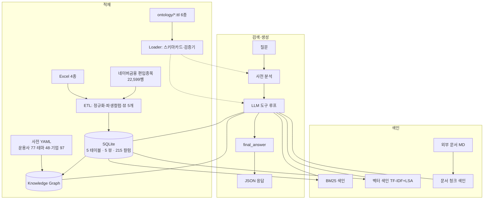
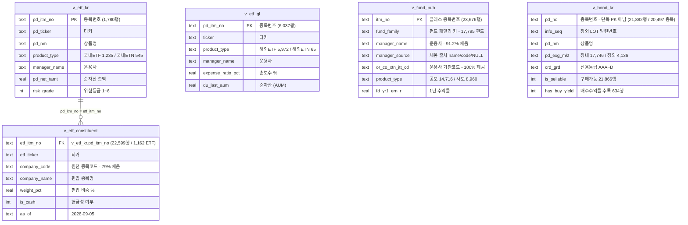
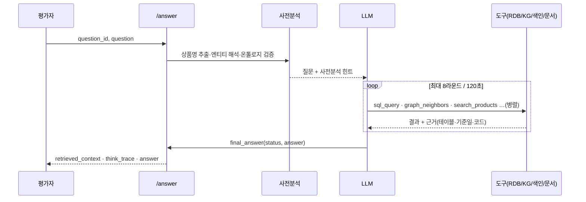

# 기술제안서 초안 (권장 목차 기준) — 금융상품 Agent

> 제출용 PDF 작성을 위한 뼈대. 각 절의 다이어그램은 mermaid 로 그려 두었으니 PDF 변환 시 이미지로 내보내면 됩니다.

## 01. 전체 아키텍처 및 특화 기능

**한 줄 요약**: 온톨로지를 "문서"가 아닌 "실행 계층"으로 쓰는 Federated Query Agent. 정형 마스터는 SQL, 관계(운용사·테마·편입종목·자회사)는 그래프, 이름·서술 텍스트는 어휘 색인, 배경 지식은 외부 문서로 각각 라우팅하고, 답변 전에 값 도메인을 검증해 환각과 답변불가 문항 오답을 줄인다.

차별화 포인트
1. **사전 분석(Deterministic pre-analysis)** — LLM 호출 전에 상품명 스팬 추출·엔티티 해석·테마/기업 사전 매칭·온톨로지 값 검증을 수행해 첫 턴에 힌트로 주입 → 라운드 수 감소(응답 시간↓), 답변불가 문항(AAAA, 7등급, 미존재 상품) 조기 판별.
2. **온톨로지 → 스키마 카드/검증기 자동 생성** — TTL의 `fp:sourceColumn`·열거형 개체·SHACL 을 런타임이 읽어 프롬프트와 검증기를 만든다(기술세션의 "런타임 식별 +20pp" 관점).
3. **측정 기반 하이브리드 검색** — BM25와 벡터(TF-IDF+LSA 384차원)를 RRF로 대등 결합했더니 두 검색기가 함께 중간 순위로 올린 무관 문서가 최상위 어휘 매칭을 밀어내는 현상을 관측(“배터리 양극재” 1위 오염). 최종안은 어휘 결과가 head를, 의미 검색 전용 문서가 하위 30% 슬롯을 갖는 구조로, 하이브리드가 어휘 검색보다 나빠지지 않음을 구조적으로 보장. 벡터 전처리도 `max_df=0.005`(한글 상품명 보일러플레이트 제거)로 프로브 정확도 1/7 → 6/7 개선.
4. **온톨로지 추론 물질화** — TBox를 런타임 그래프에 병합하고 상위 클래스 상속·역관계·domain/range를 적용. `?p a fp:Product`, `?am fp:manages ?p` 같은 질의가 별도 적재 없이 성립(기술세션 01-4의 “2개를 넣으면 5개가 된다”를 실제 파이프라인으로 구현). 현재 그래프 약 **1,074,824 트리플 · 술어 73종**.
5. **편입종목을 RDB와 그래프에 동시에** — 국내 ETF 1,162종목의 상위 편입종목 22,599행을 수집해 **SQLite 테이블 `etf_constituent`로 적재**하고, 지식그래프의 `hasConstituent`를 그 테이블에서 생성. 같은 원천을 쓰므로 SQL 결과와 그래프 결과가 갈라지지 않는다(삼성전자 229/229, 에코프로비엠 42/42로 대조 확인). 기업 식별은 원천이 주는 **종목코드**로만 하고 이름 유사도는 쓰지 않는다.
   - 다만 `subsidiaryOf`(모회사·자회사)는 **엣지 4개**뿐이다. 주최측 4종 마스터에 소유 관계 컬럼이 아예 없어, 제공 데이터에서 계산한다는 규칙을 지켜 확장하지 않았다. "다단계 자회사 순회"를 일반 기능으로 주장하지 않으며, 실제로 동작하는 범위는 사전에 명시한 에코프로 계열·SK이노베이션이다.
6. **답변 정책 상태기계** — `answered / cannot_confirm / clarify` 3상태를 도구 스키마로 강제하고, 위반 시 서버가 보정.
7. **무중단 계약** — 항상 200 + 5필드, 시간 예산 120초·최대 8라운드, 예산 임박 시 강제 종료 후 확보 근거로 답변.

## 02. 제안 방법

### 어떤 특화 데이터를 어떻게 수집·정제했는가
- 주최측 4종 마스터: 코드형 숫자 컬럼을 문자열로 고정(선행 0 보존), yyyymmdd→ISO, `is_sellable`(상환 미도래 채권 **21,866행**)·`has_buy_yield`(매수수익률 수록 634행)·`is_on_sale`·`fund_family`(펀드 클래스 23,676행 = **17,795 패밀리**)·`manager_name` 파생. 기준일을 `meta` 테이블에 기록해 근거에 자동 표기. 5개 뷰의 **제공 컬럼 215개를 전량 노출**(선별하지 않음 — 이유는 05-2 참조).
- 편입종목: 네이버금융 API(상위 종목·비중), 1,235 ETF 중 1,162 성공, 22,599행. **SQLite 테이블로 적재**하고 그래프를 그 테이블에서 생성. 원천이 주는 `itemCode`를 보존해 79% 행이 종목코드를 갖는다. 캐시·재수집 스크립트 제공.
- 사전: 운용사 77개(브랜드 접두어 TIGER/KODEX/RISE…), 테마 48개(한/영 동의어), 기업 97개(별칭·티커·모회사·비상장 여부, 한무기=캠브리콘 등 중국명 대응).
- 비정형: 국민성장펀드 보도자료 등을 PDF→Markdown(`parse_docs.py`)으로 변환, front-matter에 출처·기준일.

### 결측치를 어떻게 식별하고 보완했는가

전제: 주최측 공지에 따라 **제공 데이터의 0·결측은 의도된 값**이다. 그래서 원본 컬럼의 결측은 채우지 않고 계산에서 제외하며, 답변에는 "제공되지 않음"이라고 밝힌다. 보완 대상은 *우리가 만든 파생 컬럼*이며, 보완의 근거는 반드시 **제공 데이터 안**에 있어야 한다.

**식별 방법** — 뷰별로 컬럼 NULL 비율을 전수 점검하고, 파생 컬럼은 그 유도 근거(어느 원본 컬럼에서 왔는가)까지 함께 기록했다. 이 점검에서 파생 컬럼 하나가 눈에 띄었다.

**작업 예시: 펀드 운용사(`manager_name`) 복구**

| 단계 | 내용 |
|---|---|
| 증상 | 공모펀드 23,676행 중 **25.4%(6,016행)** 에 운용사가 비어 있음 |
| 원인 | 운용사를 **펀드 이름의 접두어에서 추측**하고 있었다. 이름에 브랜드가 드러나지 않는 펀드는 채울 방법이 없었다 |
| 더 나은 근거 | 주최측이 `or_co_xtn_itt_cd`(운용사 기관코드)를 **100% 채워서 제공**하고 있었다. 추측이 아니라 코드에서 유도할 수 있다 |
| 보완 | 기관코드별로 관측된 운용사 표기를 모아 다수 표기를 대표명으로 삼고, 이름 접두어로 못 채운 행을 코드로 채움 |
| 결과 | 17,660행(74.6%) → **21,592행(91.2%)**. 남은 NULL 2,084행 |
| 추적성 | 어느 근거로 채웠는지를 새 컬럼 **`manager_source`** 에 남김 — `name` 17,660 / `code` 3,932 / NULL 2,084 |

**보완하지 않기로 한 것**

- **운용사 개명 대응표**: 한 기관코드에 옛 브랜드와 새 브랜드가 함께 관측되는 경우가 있다. 그러나 제공 데이터에 **펀드 설정일이 없어** 두 표기 중 어느 쪽이 현재 이름인지 판정할 근거가 없다. 외부 표를 끌어오면 규칙("제공 데이터에서 계산") 밖으로 나가므로, 다수 표기를 그대로 쓴다 — 그것이 옛 브랜드여도.
- **국내ETF 총보수(18%만 수록) · 펀드 수익률(약 30%만 수록) · 펀드 보수 컬럼의 단위**: 원천이 주지 않은 값이다. 추정하지 않고 "데이터 없음"으로 답한다. 펀드 보수는 단위 미공개이므로 **클래스 간 상대 비교만** 허용한다.
- **`subsidiaryOf`(모회사·자회사)**: 주최측 4종 마스터에 소유 관계 컬럼이 없다. 사전에 손으로 적은 **엣지 4개**가 전부이며, 이를 일반 기능으로 주장하지 않는다.

**식별 방법 하나를 더 적어 둔다** — 결측이 아니라 *조용한 오류*를 잡는 방법이다. 파이프라인의 한 채움 단계는 `pandas`의 `Series.map`이 `None`을 돌려주면 `NaN`이 되고 `NaN`은 참이라는 이유로 **아무 행도 채우지 않은 채 성공을 보고**하고 있었다. 예외도 없고 로그도 없고 테스트도 초록이었다. 그래서 이 프로젝트는 각 채움 단계마다 **작업 전후의 채움 건수를 다시 세어 비교하는 것**을 절차로 두었다. 성공 여부가 아니라 개수를 본다.

### 데이터 모델 (뷰 5개)

- **실제 외래키는 하나뿐이다.** `v_etf_constituent.etf_itm_no` → `v_etf_kr.pd_itm_no`. 나머지 네 뷰는 상품군이 달라 공통 키가 없으므로 교차질의는 조인이 아니라 `UNION ALL`로 푼다.
- `v_fund_pub` 1행 = 펀드 **클래스** 1개. "펀드 몇 개"는 `COUNT(DISTINCT fund_family)`.
- `v_bond_kr`은 한 `pd_no`에 여러 행(장내/장외, 장외는 LOT 단위 `info_seq`). 종목 수는 `COUNT(DISTINCT pd_no)`.
- 해외ETF·공모펀드의 편입종목 데이터는 없다.
- 위 표는 조인·식별 컬럼만 뽑은 것이고, 실제로는 5개 뷰에 **215개 컬럼**이 있으며 전량이 스키마 카드로 노출된다.

### 어떤 온톨로지 엔지니어링을 적용했는가
- TBox **6파일**(`common` · `bond_kr` · `etf_kr` · `etf_gl` · `fund_pub` · `etf_constituent`): `fp:Product` 상위 클래스, 상품군별 하위 클래스, 열거형 개체(신용등급 20단계 서열, 위험등급 6단계, 자산군·지역·분배주기), 관계 속성(운용·발행·편입·자회사·테마·지수), SHACL 제약. 속성 정의 261개 중 **215개가 실제 뷰 컬럼에 연결**(`fp:sourceTable`/`fp:sourceColumn`).
- **클래스 도메인을 테이블 실제 구성에 맞춤**: `v_etf_kr`은 국내ETF 1,235건과 국내ETN 545건을, `v_etf_gl`은 해외ETF 5,972건과 해외ETN 65건을 같은 컬럼에 담는다. 속성 `domain`이 ETF 클래스만 가리키면 ETN 행이 잘못 분류되므로, `fp:DomesticListedProduct` / `fp:ForeignListedProduct` 두 클래스를 추가해 도메인이 테이블의 모든 행 유형을 덮게 했다.
- 런타임 결합: 속성의 `fp:sourceTable/sourceColumn/unit` → 스키마 카드; 열거형 → 값 검증기(`AA- 이상` = 서열 ≤ 4 등급 목록 자동 생성). 
- ABox 자동 구축: SQLite→트리플 약 **107만** 개(상품·운용사·지수·테마·기업·패밀리·편입). 술어는 73종 — 편입 비중을 기업마다 다른 술어(`weight_<기업명>`, 5,082종)로 적던 것을 컬럼으로 접었다.

### 어떤 검색 방법론을 선택했고 왜 그렇게 설계했는가
- 질의 요소별 라우팅: 숫자 필터/정렬/집계 → SQL, 관계 순회 → 그래프, 이름·서술 매칭 → BM25(+한글 bigram, 정확명 부스트), 배경 지식 → 문서.
- 단일 검색기의 한계(기술세션 벤치마크)를 고려해 LLM이 여러 도구를 조합해 소스를 결합하고, 근거를 구조화해 `retrieved_context` 로 반환.
  - 다만 실측(05-2 ③)에서 모델이 실제로 쓴 도구는 `sql_query`에 크게 치우쳤고 다섯 개 도구는 한 번도 호출되지 않았다. 라우팅은 "모델이 알아서 고른다"에 맡기지 않고, **필요한 정보를 프롬프트에 미리 실어 주는 쪽**으로 설계를 옮겼다(컬럼 215개 전량 노출, 사전 분석 힌트 주입).
- 벡터는 외부 임베딩 키 없이 재현 가능한 TF-IDF+LSA를 기본으로 하고, 상용 임베딩은 환경변수 전환(`VECTOR_BACKEND=openai`)으로 열어 둠.

## 03. 시스템 구성도 (적재 → 색인 → 검색 → 생성)
(01 다이어그램 재사용 + 컨테이너 배포도: NCP VM · Docker · Caddy HTTPS)

## 04. 주요 기능 흐름도 (데이터 수집 → 온톨로지 설계 → 그래프 구축 → 검색)

예시 시나리오 3개(상/중/하)와 답변불가 시나리오 2개를 실제 응답 JSON으로 첨부(`data/eval/results.jsonl` · `data/eval/truth_results.jsonl`). 정답 키는 54문항(하 10 · 중 16 · 상 9 · 답변불가 19).

## 05. 기대효과·확장성
- 현업: 상담 보조·상품 탐색·컴플라이언스(근거 표기, 전망 금지) 내재화. 기준일·근거가 항상 붙어 감사 추적 가능.
- 확장: 새 상품군 = 뷰 1개 + TTL 1개 + 사전 항목 추가로 끝(로더가 스키마 카드·검증기 자동 생성). 편입종목·공시 문서 파이프라인 추가로 그래프 확대. LLM 제공자 교체는 환경변수 1개.

## 05-1. 주최측 공지 반영 (2026-08-24)
- **LLM**: 답변 생성 파이프라인 NCP HyperCLOVA X 필수 → CLOVA Studio OpenAI 호환 엔드포인트(`HCX-005`)로 function calling 수행. 어댑터 구조라 제공자 교체 비용이 0에 가까웠음.
- **구매가능 정의 변경**: `BUYABLE_QUANTITY` 무효 공지에 따라 "상환 미도래 = 구매가능"으로 재정의(채권 634건 → 21,866건). 평가 답이 크게 달라지는 항목이라 ETL·테스트·프롬프트를 함께 수정.
- **결측/0 처리**: 의도된 결측이므로 0으로 계산하지 않고 제외 또는 "제공되지 않음" 명시.
- **교차질의**: 상품군 UNION 패턴을 프롬프트에 내장. 해외ETF는 1년 수익률 미수록이므로 비교 대상에서 제외하고 그 사실을 답변에 밝히도록 지시.
- **응답시간**: 300초 미응답 기준에 맞춰 내부 예산 120초·8라운드로 상향(정확도 우선, 300초 여유 확보). 실측 결과 지연을 만드는 것은 프롬프트 크기가 아니라 **왕복 횟수**였다(05-2).

## 05-2. 측정으로 확인한 것 (2026-09-06)

설계 주장 중 측정으로 뒷받침되는 것만 아래에 적는다. 측정하지 않은 것은 측정하지 않았다고 적는다.

**① 프롬프트 크기는 지연을 만들지 않는다.** 프롬프트 599 / 5,591 / 8,789 / 13,495 토큰에 대한 첫 호출 지연 중앙값은 2.90 / 3.65 / 2.94 / 3.82초였다. 22배 커지는 동안 사실상 평평하다. 이전에 관측된 35초짜리 호출은 크기 때문이 아니라 **테스트앱 등급의 rate limit 대기**였다.
→ 따라서 스키마 카드에 컬럼 215개를 전부 실어도 응답 시간에서 손해를 보지 않는다.

**② 지연을 만드는 것은 왕복 횟수다.** 라운드를 하나 더 도는 한계 비용은 1→2 **+11.2초**, 2→3 +1.8초, 3→4 +3.7초. 첫 왕복이 가장 비싸다. 그런데 22문항 중 **17문항**이 제출 직전에 도구를 부르지 않고 텍스트만 내보내는 라운드를 한 번 소비한다 — 답에 아무것도 더하지 않는 왕복이다. 답변 길이와 소요 시간의 상관계수는 **0.00**이었다(길게 쓰는 게 느린 것이 아니다).

**③ 모델은 스키마를 물어보지 않는다.** 22문항 동안의 도구 호출은 `sql_query` 24회, `final_answer` 20회, `graph_neighbors` 2회, 그리고 `table_info`·`search_products`·`resolve_entity`·`graph_query`·`search_documents`는 **각각 0회**였다.
→ 프롬프트에 처음부터 실려 있지 않은 컬럼은 모델에게 존재하지 않는 것과 같다. 실제로 `has_buy_yield`는 프롬프트의 컬럼 목록에는 있었으나 온톨로지 정의가 없어 스키마 카드에 나타나지 않았고, 모델은 그 컬럼을 쓰지 않았다. 이것이 **제공 컬럼을 선별하지 않고 215개 전량을 노출**하기로 한 이유다.

**④ 지식그래프의 출처 구성.** 약 1,074,824 트리플 중 주최측 마스터 유래 **58.9%**, 온톨로지·추론 **27.0%**, 우리 사전 **8.1%**, 외부 수집(국내 ETF 편입종목) **6.0%**. 제공 데이터에 뿌리를 둔 것이 85.9%이며, 외부 수집은 제공 데이터에 컬럼 자체가 없는 항목 하나뿐이다.

**⑤ SQL과 그래프가 같은 답을 낸다.** 편입종목이 SQLite 테이블로 내려오고 그래프가 그 테이블에서 생성되도록 바꾼 뒤, 다섯 기업으로 두 경로를 대조했다: 삼성전자 229/229 · 삼성전자우 19/19 · 에코프로비엠 42/42 · LG 26/26 · KT 48/48.

**아직 측정하지 않은 것 (제출 시 반드시 채울 것)**

- **정답 정확도.** 정답 키를 20 → 54문항으로 확장하면서 키 자체의 오류도 함께 고쳤으므로(ETF를 묻는 문항에서 ETN을 센 것, 최저 총보수 0.01%에 4개가 동률인데 하나만 정답으로 고정한 것, 반올림 정수를 허용해 0.65가 "1"로도 통과한 것, "…상품은 없습니다"를 거절로 인식하지 못한 채점기), 이전 채점 결과는 폐기했고 새 세트로는 아직 실행하지 않았다. **이 문서에 정답률 숫자를 쓰지 않는다.**
- 컨테이너 기동 시간(편입종목 테이블 추가·그래프 재구축 이후 재측정 필요).

**품질 관리 원칙으로 삼은 것** — 이번 점검에서 발견한 결함 11건은 전부 예외도 로그도 빨간 테스트도 없이 통과했다. 관계 수가 두 배로 부풀려진 채 "정답"이었고(정답 키를 같은 코드로 계산했기 때문), 상한에 잘린 개수가 총계라는 이름으로 보고됐고, 아무 행도 채우지 않은 단계가 성공을 보고했다. 그래서 이 프로젝트는 **바꾼 뒤에 결과를 다시 세는 것**을 절차로 둔다 — SQL로 나온 값을 그래프로, 그래프로 나온 값을 SQL로 한 번 더 세어 대조한다.

## 06. 부록
- 온톨로지 스키마 요약표(클래스/속성/열거형: 6파일 · 속성 261개 중 215개가 뷰 컬럼에 연결), API 명세(`docs/api_spec.md`), 평가 재현 절차(README 7절), 테스트 목록, 데이터 제한 사항, 시스템 해부도(`docs/anatomy.html` — 차트·ERD 포함).
