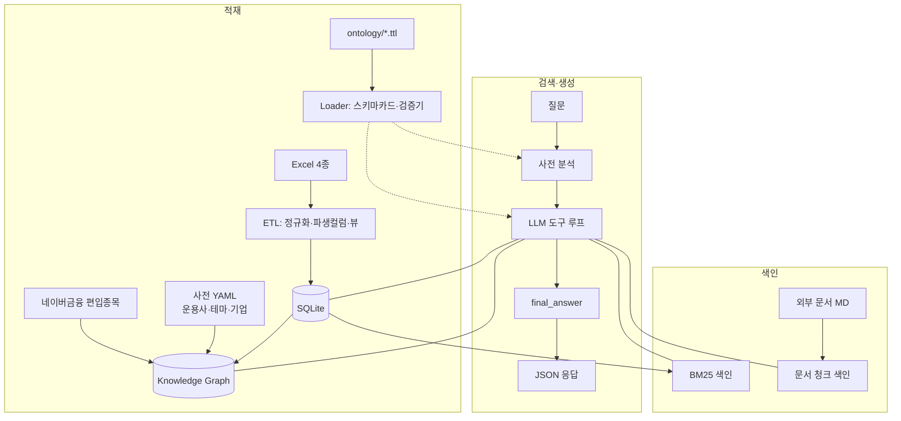

# 기술제안서 초안 (권장 목차 기준) — 금융상품 Agent

> 제출용 PDF 작성을 위한 뼈대. 각 절의 다이어그램은 mermaid 로 그려 두었으니 PDF 변환 시 이미지로 내보내면 됩니다.

## 01. 전체 아키텍처 및 특화 기능

**한 줄 요약**: 온톨로지를 "문서"가 아닌 "실행 계층"으로 쓰는 Federated Query Agent. 정형 마스터는 SQL, 관계(운용사·테마·편입종목·자회사)는 그래프, 이름·서술 텍스트는 어휘 색인, 배경 지식은 외부 문서로 각각 라우팅하고, 답변 전에 값 도메인을 검증해 환각과 답변불가 문항 오답을 줄인다.

차별화 포인트
1. **사전 분석(Deterministic pre-analysis)** — LLM 호출 전에 상품명 스팬 추출·엔티티 해석·테마/기업 사전 매칭·온톨로지 값 검증을 수행해 첫 턴에 힌트로 주입 → 라운드 수 감소(응답 시간↓), 답변불가 문항(AAAA, 7등급, 미존재 상품) 조기 판별.
2. **온톨로지 → 스키마 카드/검증기 자동 생성** — TTL의 `fp:sourceColumn`·열거형 개체·SHACL 을 런타임이 읽어 프롬프트와 검증기를 만든다(기술세션의 "런타임 식별 +20pp" 관점).
3. **편입종목 그래프** — 국내 ETF 1,162종목의 상위 편입종목을 수집해 `hasConstituent`, 기업 사전의 `subsidiaryOf` 와 결합. "에코프로 자회사를 편입한 ETF", "캠브리콘(한무기) 편입 중국반도체 ETF" 같은 다단계 질의를 그래프 순회로 해결.
4. **답변 정책 상태기계** — `answered / cannot_confirm / clarify` 3상태를 도구 스키마로 강제하고, 위반 시 서버가 보정.
5. **무중단 계약** — 항상 200 + 5필드, 시간 예산 50초, 예산 임박 시 강제 종료 후 확보 근거로 답변.

## 02. 제안 방법

### 어떤 특화 데이터를 어떻게 수집·정제했는가
- 주최측 4종 마스터: 코드형 숫자 컬럼을 문자열로 고정(선행 0 보존), yyyymmdd→ISO, `is_sellable`(채권 634건)·`is_on_sale`·`fund_family`(펀드 클래스 17,795 패밀리)·`manager_name`(사전 정규화) 파생. 기준일을 `meta` 테이블에 기록해 근거에 자동 표기.
- 편입종목: 네이버금융 API(상위 종목·비중), 1,235 ETF 중 1,162 성공, 22,599행. 캐시·재수집 스크립트 제공.
- 사전: 운용사 77개(브랜드 접두어 TIGER/KODEX/RISE…), 테마 48개(한/영 동의어), 기업 91개(별칭·티커·모회사·비상장 여부, 한무기=캠브리콘 등 중국명 대응).
- 비정형: 국민성장펀드 보도자료 등을 PDF→Markdown(`parse_docs.py`)으로 변환, front-matter에 출처·기준일.

### 어떤 온톨로지 엔지니어링을 적용했는가
- TBox 5파일: `fp:Product` 상위 클래스, 상품군별 하위 클래스, 열거형 개체(신용등급 20단계 서열, 위험등급 6단계, 자산군·지역·분배주기), 관계 속성(운용·발행·편입·자회사·테마·지수), SHACL 제약.
- 런타임 결합: 속성의 `fp:sourceTable/sourceColumn/unit` → 스키마 카드; 열거형 → 값 검증기(`AA- 이상` = 서열 ≤ 4 등급 목록 자동 생성). 
- ABox 자동 구축: SQLite→트리플 약 100만 개(상품·운용사·지수·테마·기업·패밀리·편입).

### 어떤 검색 방법론을 선택했고 왜 그렇게 설계했는가
- 질의 요소별 라우팅: 숫자 필터/정렬/집계 → SQL, 관계 순회 → 그래프, 이름·서술 매칭 → BM25(+한글 bigram, 정확명 부스트), 배경 지식 → 문서.
- 단일 검색기의 한계(기술세션 벤치마크)를 고려해 LLM이 병렬 도구 호출로 소스를 결합하고, 근거를 구조화해 `retrieved_context` 로 반환.
- 벡터 임베딩은 외부 키 의존·지연을 피하기 위해 BM25 로 대체(확장 지점 명시).

## 03. 시스템 구성도 (적재 → 색인 → 검색 → 생성)
(01 다이어그램 재사용 + 컨테이너 배포도: NCP VM · Docker · Caddy HTTPS)

## 04. 주요 기능 흐름도 (데이터 수집 → 온톨로지 설계 → 그래프 구축 → 검색)

예시 시나리오 3개(상/중/하)와 답변불가 시나리오 2개를 실제 응답 JSON으로 첨부(`data/eval/results.jsonl`).

## 05. 기대효과·확장성
- 현업: 상담 보조·상품 탐색·컴플라이언스(근거 표기, 전망 금지) 내재화. 기준일·근거가 항상 붙어 감사 추적 가능.
- 확장: 새 상품군 = 뷰 1개 + TTL 1개 + 사전 항목 추가로 끝(로더가 스키마 카드·검증기 자동 생성). 편입종목·공시 문서 파이프라인 추가로 그래프 확대. LLM 제공자 교체는 환경변수 1개.

## 06. 부록
- 온톨로지 스키마 요약표(클래스/속성/열거형), API 명세(docs/api_spec.md), 평가 재현 절차(README 7절), 테스트 목록, 데이터 제한 사항.
